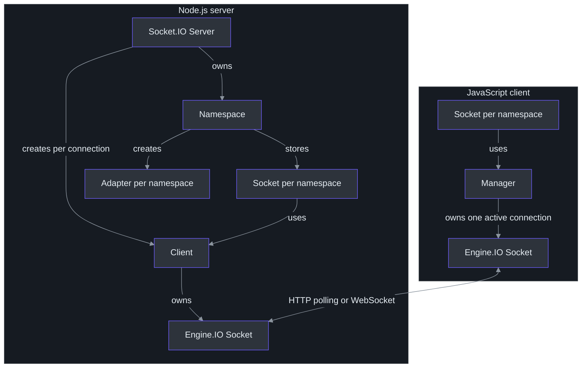
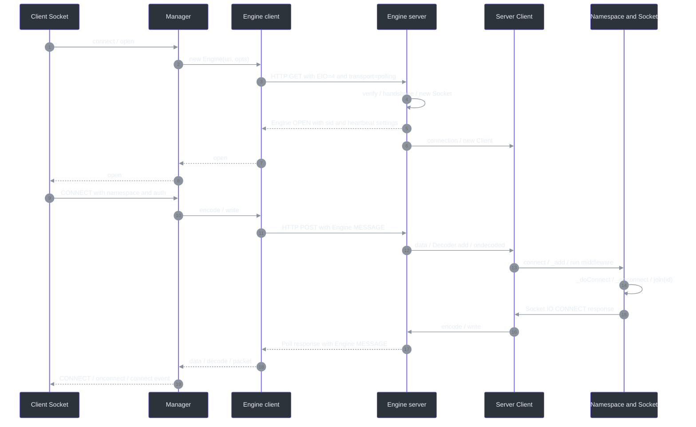
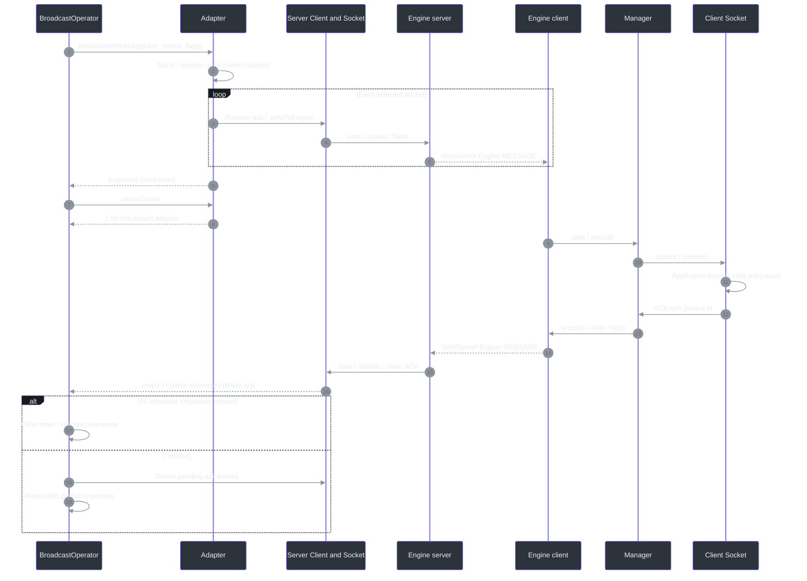
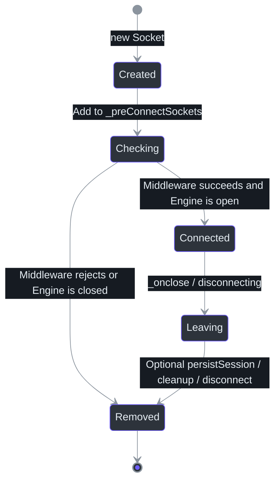
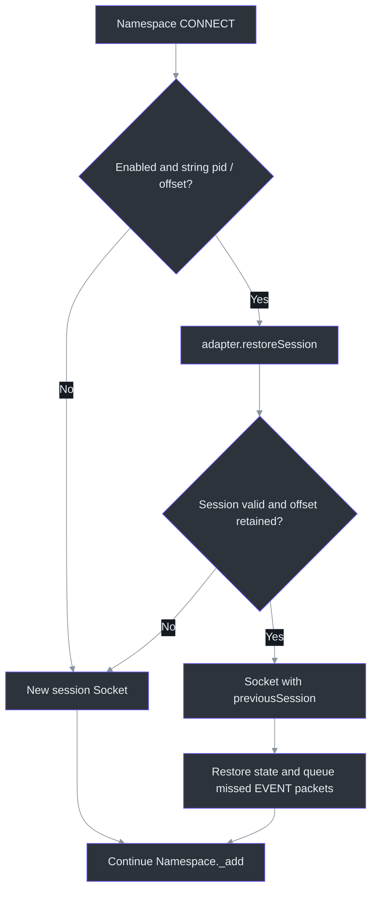

# Socket.IO 源码架构

## 概览与证据范围

Socket.IO 在 Engine.IO 的连接之上实现命名空间、事件和房间广播。客户端用 `Manager` 复用底层连接，服务端用 `Client` 把同一连接上的数据分发给不同命名空间的 `Socket`；`Adapter` 决定广播接收者。理解这三组边界，比从单个 `Socket` 类顺序阅读更有效。上述对象关系是**已验证事实／高**，阅读建议是**推断／中**。关键入口：`Server.onconnection`、`Client.ondecoded`、`lookup` 和 `Adapter.apply`。Source：[packages/socket.io/lib/index.ts:735-758](https://github.com/SunsetWan/socket.io/blob/1eaa582d3b453e3e6f522300ed05b10da0a0799b/packages/socket.io/lib/index.ts#L735-L758)、[packages/socket.io/lib/client.ts:279-305](https://github.com/SunsetWan/socket.io/blob/1eaa582d3b453e3e6f522300ed05b10da0a0799b/packages/socket.io/lib/client.ts#L279-L305)、[packages/socket.io-client/lib/index.ts:47-73](https://github.com/SunsetWan/socket.io/blob/1eaa582d3b453e3e6f522300ed05b10da0a0799b/packages/socket.io-client/lib/index.ts#L47-L73)、[packages/socket.io-adapter/lib/in-memory-adapter.ts:333-358](https://github.com/SunsetWan/socket.io/blob/1eaa582d3b453e3e6f522300ed05b10da0a0799b/packages/socket.io-adapter/lib/in-memory-adapter.ts#L333-L358)。

| 项目 | 范围 |
| --- | --- |
| 分析基线 | `sunset-learn` 的起点提交 `1eaa582d3b453e3e6f522300ed05b10da0a0799b`；源码链接固定到该提交，避免后续 `main` 变动导致行号漂移。 |
| 源码范围 | 根目录的 12 个 workspace；重点追踪 Node.js 服务端、JavaScript 客户端、默认内存 Adapter、Engine.IO v4 和 Socket.IO 协议 v5。 |
| 已验证事实／高 | 已阅读实现、调用点或依赖声明；指源码核对，不表示已运行行为测试。下文未单独标注的组件表和调用步骤均属此类。 |
| 推断／中 | 根据已核对实现得到的设计解释、风险判断或阅读建议；不冒充项目作者的设计意图。 |
| 未确认 | 未追踪的实现或未执行的运行场景；不据此作兼容性、可靠性或性能保证。 |

Workspace 清单来自 `workspaces`；协议版本来自各 parser 的 `protocol`，不能用 npm 包版本代替协议版本。Source：[package.json:4-17](https://github.com/SunsetWan/socket.io/blob/1eaa582d3b453e3e6f522300ed05b10da0a0799b/package.json#L4-L17)、[packages/engine.io-parser/lib/index.ts:199](https://github.com/SunsetWan/socket.io/blob/1eaa582d3b453e3e6f522300ed05b10da0a0799b/packages/engine.io-parser/lib/index.ts#L199)、[packages/socket.io-parser/lib/index.ts:26-44](https://github.com/SunsetWan/socket.io/blob/1eaa582d3b453e3e6f522300ed05b10da0a0799b/packages/socket.io-parser/lib/index.ts#L26-L44)。

根目录是 `private: true` 的 npm workspaces 单仓。服务端包的公开入口指向 `dist/index.js` 或 ESM wrapper，客户端包的入口指向 `build` 下的对应构建；下文引用 `lib` 中的实现源码。关键配置是 `workspaces`、`main` 和 `exports`。Source：[package.json:1-17](https://github.com/SunsetWan/socket.io/blob/1eaa582d3b453e3e6f522300ed05b10da0a0799b/package.json#L1-L17)、[packages/socket.io/package.json:28-40](https://github.com/SunsetWan/socket.io/blob/1eaa582d3b453e3e6f522300ed05b10da0a0799b/packages/socket.io/package.json#L28-L40)、[packages/socket.io-client/package.json:14-38](https://github.com/SunsetWan/socket.io/blob/1eaa582d3b453e3e6f522300ed05b10da0a0799b/packages/socket.io-client/package.json#L14-L38)。

## 1. 核心抽象与模块职责

### 1.1 对象如何分工

| 抽象与关键符号 | 职责与状态归属 | Source |
| --- | --- | --- |
| 服务端 `Server` | 配置 parser、Adapter 和 HTTP 挂载；保存 `_nsps`，`sockets` 指向默认命名空间 `/`。 | [packages/socket.io/lib/index.ts:255-285](https://github.com/SunsetWan/socket.io/blob/1eaa582d3b453e3e6f522300ed05b10da0a0799b/packages/socket.io/lib/index.ts#L255-L285)、[packages/socket.io/lib/index.ts:323-344](https://github.com/SunsetWan/socket.io/blob/1eaa582d3b453e3e6f522300ed05b10da0a0799b/packages/socket.io/lib/index.ts#L323-L344) |
| 服务端 `Client` | 对应一个 Engine.IO 连接，持有一个 Decoder；用 `nsps` 和 `sockets` 管理该连接加入的命名空间，负责解码和路由。它不是用户业务层拿到的 `Socket`。 | [packages/socket.io/lib/client.ts:44-82](https://github.com/SunsetWan/socket.io/blob/1eaa582d3b453e3e6f522300ed05b10da0a0799b/packages/socket.io/lib/client.ts#L44-L82)、[packages/socket.io/lib/client.ts:166-177](https://github.com/SunsetWan/socket.io/blob/1eaa582d3b453e3e6f522300ed05b10da0a0799b/packages/socket.io/lib/client.ts#L166-L177)、[packages/socket.io/lib/client.ts:264-305](https://github.com/SunsetWan/socket.io/blob/1eaa582d3b453e3e6f522300ed05b10da0a0799b/packages/socket.io/lib/client.ts#L264-L305) |
| `Namespace` | 保存已连接和连接中的 Socket、连接中间件及本命名空间的 Adapter；`_add` 执行接入流程，`_doConnect` 发布连接事件。 | [packages/socket.io/lib/namespace.ts:136-203](https://github.com/SunsetWan/socket.io/blob/1eaa582d3b453e3e6f522300ed05b10da0a0799b/packages/socket.io/lib/namespace.ts#L136-L203)、[packages/socket.io/lib/namespace.ts:335-427](https://github.com/SunsetWan/socket.io/blob/1eaa582d3b453e3e6f522300ed05b10da0a0799b/packages/socket.io/lib/namespace.ts#L335-L427) |
| 服务端 `Socket` | 属于一个 Namespace，引用一个 Client；保存 `id`、恢复用 `pid`、`data` 和 ACK 回调。房间成员关系通过 `join` 委托给 Adapter。 | [packages/socket.io/lib/socket.ts:158-194](https://github.com/SunsetWan/socket.io/blob/1eaa582d3b453e3e6f522300ed05b10da0a0799b/packages/socket.io/lib/socket.ts#L158-L194)、[packages/socket.io/lib/socket.ts:461-467](https://github.com/SunsetWan/socket.io/blob/1eaa582d3b453e3e6f522300ed05b10da0a0799b/packages/socket.io/lib/socket.ts#L461-L467)、[packages/socket.io/lib/socket.ts:601-606](https://github.com/SunsetWan/socket.io/blob/1eaa582d3b453e3e6f522300ed05b10da0a0799b/packages/socket.io/lib/socket.ts#L601-L606) |
| `BroadcastOperator` | 保存目标房间、排除房间和发送标志；`to` 返回新的操作对象，`emit` 选择普通广播或收集 ACK 的广播。 | [packages/socket.io/lib/broadcast-operator.ts:20-59](https://github.com/SunsetWan/socket.io/blob/1eaa582d3b453e3e6f522300ed05b10da0a0799b/packages/socket.io/lib/broadcast-operator.ts#L20-L59)、[packages/socket.io/lib/broadcast-operator.ts:209-306](https://github.com/SunsetWan/socket.io/blob/1eaa582d3b453e3e6f522300ed05b10da0a0799b/packages/socket.io/lib/broadcast-operator.ts#L209-L306) |
| 客户端 `Manager` 与 `Socket` | Manager 拥有 Engine.IO 客户端、编解码器和重连退避；Socket 对应命名空间，持有业务收发缓冲、ACK 和重试队列。 | [packages/socket.io-client/lib/manager.ts:110-188](https://github.com/SunsetWan/socket.io/blob/1eaa582d3b453e3e6f522300ed05b10da0a0799b/packages/socket.io-client/lib/manager.ts#L110-L188)、[packages/socket.io-client/lib/socket.ts:210-291](https://github.com/SunsetWan/socket.io/blob/1eaa582d3b453e3e6f522300ed05b10da0a0799b/packages/socket.io-client/lib/socket.ts#L210-L291) |
| Engine.IO `Socket` 与 `Transport` | Socket 管会话、心跳、写缓冲和传输升级；Transport 执行 polling、WebSocket 等实际收发。 | [packages/engine.io/lib/socket.ts:119-155](https://github.com/SunsetWan/socket.io/blob/1eaa582d3b453e3e6f522300ed05b10da0a0799b/packages/engine.io/lib/socket.ts#L119-L155)、[packages/engine.io/lib/socket.ts:494-557](https://github.com/SunsetWan/socket.io/blob/1eaa582d3b453e3e6f522300ed05b10da0a0799b/packages/engine.io/lib/socket.ts#L494-L557)、[packages/engine.io-client/lib/socket.ts:609-644](https://github.com/SunsetWan/socket.io/blob/1eaa582d3b453e3e6f522300ed05b10da0a0799b/packages/engine.io-client/lib/socket.ts#L609-L644) |

下图表示运行时对象之间的持有或调用关系；横跨客户端与服务端的双向箭头表示网络收发，不表示包依赖。

<!-- Sources: packages/socket.io-client/lib/manager.ts:323, packages/socket.io-client/lib/socket.ts:611, packages/socket.io/lib/index.ts:750, packages/socket.io/lib/namespace.ts:197, packages/socket.io/lib/namespace.ts:415, packages/socket.io/lib/client.ts:72, packages/socket.io/lib/client.ts:279, packages/socket.io/lib/socket.ts:461, packages/socket.io-adapter/lib/in-memory-adapter.ts:173 -->

两个具体边界值得先记住：

- **命名空间可以复用连接，房间只选择接收者。** `lookup` 的 Manager 缓存键包含协议、主机、端口和 Engine.IO 路径；`forceNew`、关闭 `multiplex` 或再次请求相同命名空间会创建新 Manager。房间是 Adapter 中的集合关系，同一个 Socket 命中多个目标房间时只发送一次。Source：`lookup`、`url`、`Adapter.apply`，[packages/socket.io-client/lib/index.ts:47-73](https://github.com/SunsetWan/socket.io/blob/1eaa582d3b453e3e6f522300ed05b10da0a0799b/packages/socket.io-client/lib/index.ts#L47-L73)、[packages/socket.io-client/lib/url.ts:83-89](https://github.com/SunsetWan/socket.io/blob/1eaa582d3b453e3e6f522300ed05b10da0a0799b/packages/socket.io-client/lib/url.ts#L83-L89)、[packages/socket.io-adapter/lib/in-memory-adapter.ts:333-369](https://github.com/SunsetWan/socket.io/blob/1eaa582d3b453e3e6f522300ed05b10da0a0799b/packages/socket.io-adapter/lib/in-memory-adapter.ts#L333-L369)。
- **同名 `Socket` 不代表同一层。** Engine.IO 的 `sid` 标识传输会话；Socket.IO 的 `Socket.id` 标识命名空间连接。在本分析采用的 EIO4 路径中，服务端生成独立的 Socket.IO ID；`pid` 只在启用恢复时生成。Source：`Socket.onOpen` 和 Socket.IO `Socket.constructor`，[packages/engine.io/lib/socket.ts:128-140](https://github.com/SunsetWan/socket.io/blob/1eaa582d3b453e3e6f522300ed05b10da0a0799b/packages/engine.io/lib/socket.ts#L128-L140)、[packages/socket.io/lib/socket.ts:167-190](https://github.com/SunsetWan/socket.io/blob/1eaa582d3b453e3e6f522300ed05b10da0a0799b/packages/socket.io/lib/socket.ts#L167-L190)。

### 1.2 全部 workspace 的职责

| 包目录（均在 `packages/` 下） | 主要职责与关键符号 | Source |
| --- | --- | --- |
| `socket.io` | 应用协议服务端：`Server`、`Namespace`、`Client`、`Socket`、`BroadcastOperator`。 | [packages/socket.io/lib/index.ts:14-35](https://github.com/SunsetWan/socket.io/blob/1eaa582d3b453e3e6f522300ed05b10da0a0799b/packages/socket.io/lib/index.ts#L14-L35)、[packages/socket.io/lib/namespace.ts:335-427](https://github.com/SunsetWan/socket.io/blob/1eaa582d3b453e3e6f522300ed05b10da0a0799b/packages/socket.io/lib/namespace.ts#L335-L427) |
| `socket.io-client` | 应用协议客户端：`lookup` 选择 Manager；`Manager` 管连接；`Socket` 管命名空间事件。 | [packages/socket.io-client/lib/index.ts:36-73](https://github.com/SunsetWan/socket.io/blob/1eaa582d3b453e3e6f522300ed05b10da0a0799b/packages/socket.io-client/lib/index.ts#L36-L73)、[packages/socket.io-client/lib/manager.ts:318-332](https://github.com/SunsetWan/socket.io/blob/1eaa582d3b453e3e6f522300ed05b10da0a0799b/packages/socket.io-client/lib/manager.ts#L318-L332)、[packages/socket.io-client/lib/socket.ts:706-745](https://github.com/SunsetWan/socket.io/blob/1eaa582d3b453e3e6f522300ed05b10da0a0799b/packages/socket.io-client/lib/socket.ts#L706-L745) |
| `engine.io` | `Server.handleRequest` 接入 HTTP 请求；`Socket` 管心跳与缓冲；Transport 适配实际传输。 | [packages/engine.io/lib/server.ts:800-841](https://github.com/SunsetWan/socket.io/blob/1eaa582d3b453e3e6f522300ed05b10da0a0799b/packages/engine.io/lib/server.ts#L800-L841)、[packages/engine.io/lib/socket.ts:128-215](https://github.com/SunsetWan/socket.io/blob/1eaa582d3b453e3e6f522300ed05b10da0a0799b/packages/engine.io/lib/socket.ts#L128-L215)、[packages/engine.io/lib/transports/websocket.ts:17-68](https://github.com/SunsetWan/socket.io/blob/1eaa582d3b453e3e6f522300ed05b10da0a0799b/packages/engine.io/lib/transports/websocket.ts#L17-L68) |
| `engine.io-client` | `Socket` 发起握手、处理心跳和升级；默认传输表连接 XHR、WebSocket、WebTransport 实现。 | [packages/engine.io-client/lib/socket.ts:557-576](https://github.com/SunsetWan/socket.io/blob/1eaa582d3b453e3e6f522300ed05b10da0a0799b/packages/engine.io-client/lib/socket.ts#L557-L576)、[packages/engine.io-client/lib/socket.ts:753-812](https://github.com/SunsetWan/socket.io/blob/1eaa582d3b453e3e6f522300ed05b10da0a0799b/packages/engine.io-client/lib/socket.ts#L753-L812)、[packages/engine.io-client/lib/transports/index.ts:1-9](https://github.com/SunsetWan/socket.io/blob/1eaa582d3b453e3e6f522300ed05b10da0a0799b/packages/engine.io-client/lib/transports/index.ts#L1-L9) |
| `socket.io-parser` | `Encoder`、`Decoder` 处理应用协议包的类型、命名空间、ACK ID 和二进制附件。 | [packages/socket.io-parser/lib/index.ts:26-44](https://github.com/SunsetWan/socket.io/blob/1eaa582d3b453e3e6f522300ed05b10da0a0799b/packages/socket.io-parser/lib/index.ts#L26-L44)、[packages/socket.io-parser/lib/index.ts:63-130](https://github.com/SunsetWan/socket.io/blob/1eaa582d3b453e3e6f522300ed05b10da0a0799b/packages/socket.io-parser/lib/index.ts#L63-L130)、[packages/socket.io-parser/lib/index.ts:181-207](https://github.com/SunsetWan/socket.io/blob/1eaa582d3b453e3e6f522300ed05b10da0a0799b/packages/socket.io-parser/lib/index.ts#L181-L207) |
| `engine.io-parser` | `encodePacket`、`decodePayload` 等处理底层包；polling 使用分隔符组合多个包，流式接口提供 WebTransport 帧编解码。 | [packages/engine.io-parser/lib/encodePacket.ts:3-15](https://github.com/SunsetWan/socket.io/blob/1eaa582d3b453e3e6f522300ed05b10da0a0799b/packages/engine.io-parser/lib/encodePacket.ts#L3-L15)、[packages/engine.io-parser/lib/index.ts:11-55](https://github.com/SunsetWan/socket.io/blob/1eaa582d3b453e3e6f522300ed05b10da0a0799b/packages/engine.io-parser/lib/index.ts#L11-L55)、[packages/engine.io-parser/lib/index.ts:113-196](https://github.com/SunsetWan/socket.io/blob/1eaa582d3b453e3e6f522300ed05b10da0a0799b/packages/engine.io-parser/lib/index.ts#L113-L196) |
| `socket.io-adapter` | `Adapter` 维护房间双向索引；`SessionAwareAdapter` 保存可恢复会话和事件；`ClusterAdapter` 提供跨节点消息框架。 | [packages/socket.io-adapter/lib/in-memory-adapter.ts:46-104](https://github.com/SunsetWan/socket.io/blob/1eaa582d3b453e3e6f522300ed05b10da0a0799b/packages/socket.io-adapter/lib/in-memory-adapter.ts#L46-L104)、[packages/socket.io-adapter/lib/in-memory-adapter.ts:409-498](https://github.com/SunsetWan/socket.io/blob/1eaa582d3b453e3e6f522300ed05b10da0a0799b/packages/socket.io-adapter/lib/in-memory-adapter.ts#L409-L498)、[packages/socket.io-adapter/lib/cluster-adapter.ts:173-188](https://github.com/SunsetWan/socket.io/blob/1eaa582d3b453e3e6f522300ed05b10da0a0799b/packages/socket.io-adapter/lib/cluster-adapter.ts#L173-L188) |
| `socket.io-component-emitter` | 客户端和 parser 共用的进程内事件分发器 `Emitter`，负责监听器注册与调用。 | [packages/socket.io-component-emitter/lib/esm/index.js:35-42](https://github.com/SunsetWan/socket.io/blob/1eaa582d3b453e3e6f522300ed05b10da0a0799b/packages/socket.io-component-emitter/lib/esm/index.js#L35-L42)、[packages/socket.io-component-emitter/lib/esm/index.js:120-144](https://github.com/SunsetWan/socket.io/blob/1eaa582d3b453e3e6f522300ed05b10da0a0799b/packages/socket.io-component-emitter/lib/esm/index.js#L120-L144) |
| `socket.io-cluster-adapter` | `NodeClusterAdapter` 用 Node.js IPC 实现集群广播；`setupPrimary` 在 worker 间转发消息。 | [packages/socket.io-cluster-adapter/lib/index.ts:26-72](https://github.com/SunsetWan/socket.io/blob/1eaa582d3b453e3e6f522300ed05b10da0a0799b/packages/socket.io-cluster-adapter/lib/index.ts#L26-L72)、[packages/socket.io-cluster-adapter/lib/index.ts:78-115](https://github.com/SunsetWan/socket.io/blob/1eaa582d3b453e3e6f522300ed05b10da0a0799b/packages/socket.io-cluster-adapter/lib/index.ts#L78-L115) |
| `socket.io-cluster-engine` | `ClusterEngine` 扩展 Engine.IO Server，处理会话位于其他节点时的请求协调；`NodeClusterEngine` 和 `RedisEngine` 提供消息传输。 | [packages/socket.io-cluster-engine/lib/engine.ts:167-183](https://github.com/SunsetWan/socket.io/blob/1eaa582d3b453e3e6f522300ed05b10da0a0799b/packages/socket.io-cluster-engine/lib/engine.ts#L167-L183)、[packages/socket.io-cluster-engine/lib/engine.ts:425-456](https://github.com/SunsetWan/socket.io/blob/1eaa582d3b453e3e6f522300ed05b10da0a0799b/packages/socket.io-cluster-engine/lib/engine.ts#L425-L456)、[packages/socket.io-cluster-engine/lib/cluster.ts:44-64](https://github.com/SunsetWan/socket.io/blob/1eaa582d3b453e3e6f522300ed05b10da0a0799b/packages/socket.io-cluster-engine/lib/cluster.ts#L44-L64)、[packages/socket.io-cluster-engine/lib/redis.ts:133-177](https://github.com/SunsetWan/socket.io/blob/1eaa582d3b453e3e6f522300ed05b10da0a0799b/packages/socket.io-cluster-engine/lib/redis.ts#L133-L177) |
| `socket.io-postgres-emitter` | 外部进程的 `Emitter`／`BroadcastOperator` 生成广播消息，通过 PostgreSQL `pg_notify` 发布；大消息或二进制消息先写附件表。 | [packages/socket.io-postgres-emitter/lib/index.ts:358-414](https://github.com/SunsetWan/socket.io/blob/1eaa582d3b453e3e6f522300ed05b10da0a0799b/packages/socket.io-postgres-emitter/lib/index.ts#L358-L414)、[packages/socket.io-postgres-emitter/lib/index.ts:431-453](https://github.com/SunsetWan/socket.io/blob/1eaa582d3b453e3e6f522300ed05b10da0a0799b/packages/socket.io-postgres-emitter/lib/index.ts#L431-L453) |
| `socket.io-redis-streams-emitter` | 外部进程的 `Emitter.publish` 构建集群消息，`XADD` 写 Redis Stream 并设置近似长度裁剪。 | [packages/socket.io-redis-streams-emitter/lib/index.ts:472-494](https://github.com/SunsetWan/socket.io/blob/1eaa582d3b453e3e6f522300ed05b10da0a0799b/packages/socket.io-redis-streams-emitter/lib/index.ts#L472-L494)、[packages/socket.io-redis-streams-emitter/lib/util.ts:46-66](https://github.com/SunsetWan/socket.io/blob/1eaa582d3b453e3e6f522300ed05b10da0a0799b/packages/socket.io-redis-streams-emitter/lib/util.ts#L46-L66) |

`ParentNamespace` 是服务端内部的补充抽象：动态命名空间创建时复制中间件和连接监听器，再登记具体子命名空间；它不是另一个网络协议层。Source：`ParentNamespace.createChild`，[packages/socket.io/lib/parent-namespace.ts:65-98](https://github.com/SunsetWan/socket.io/blob/1eaa582d3b453e3e6f522300ed05b10da0a0799b/packages/socket.io/lib/parent-namespace.ts#L65-L98)。

## 2. 模块依赖与外部集成

| 关系 | 已验证的依赖方式及含义 | Source |
| --- | --- | --- |
| Socket.IO → Engine.IO、Adapter、parser | 服务端直接导入并装配三者；应用事件通过 Engine.IO 执行传输。 | `Server` 的 imports、`initEngine`：[packages/socket.io/lib/index.ts:14-35](https://github.com/SunsetWan/socket.io/blob/1eaa582d3b453e3e6f522300ed05b10da0a0799b/packages/socket.io/lib/index.ts#L14-L35)、[packages/socket.io/lib/index.ts:596-611](https://github.com/SunsetWan/socket.io/blob/1eaa582d3b453e3e6f522300ed05b10da0a0799b/packages/socket.io/lib/index.ts#L596-L611) |
| Socket.IO client → Engine.IO client、parser、Emitter | `Manager` 导入三者，并在 `_packet` 中把应用协议编码结果交给 Engine.IO。 | [packages/socket.io-client/lib/manager.ts:1-16](https://github.com/SunsetWan/socket.io/blob/1eaa582d3b453e3e6f522300ed05b10da0a0799b/packages/socket.io-client/lib/manager.ts#L1-L16)、[packages/socket.io-client/lib/manager.ts:504-510](https://github.com/SunsetWan/socket.io/blob/1eaa582d3b453e3e6f522300ed05b10da0a0799b/packages/socket.io-client/lib/manager.ts#L504-L510) |
| Adapter → Namespace 的运行时反向访问 | Adapter 没有导入 Socket.IO Server；构造时注入 `nsp`，再访问 `nsp.server.encoder`、`nsp.sockets` 和 `socket.client`。包依赖没有环，不代表对象之间只有单向依赖。 | `Adapter.constructor`、`broadcast`、`apply`：[packages/socket.io-adapter/lib/in-memory-adapter.ts:46-58](https://github.com/SunsetWan/socket.io/blob/1eaa582d3b453e3e6f522300ed05b10da0a0799b/packages/socket.io-adapter/lib/in-memory-adapter.ts#L46-L58)、[packages/socket.io-adapter/lib/in-memory-adapter.ts:162-179](https://github.com/SunsetWan/socket.io/blob/1eaa582d3b453e3e6f522300ed05b10da0a0799b/packages/socket.io-adapter/lib/in-memory-adapter.ts#L162-L179)、[packages/socket.io-adapter/lib/in-memory-adapter.ts:333-358](https://github.com/SunsetWan/socket.io/blob/1eaa582d3b453e3e6f522300ed05b10da0a0799b/packages/socket.io-adapter/lib/in-memory-adapter.ts#L333-L358) |
| 集群 Adapter → 基础 Adapter | `NodeClusterAdapter` 继承 `ClusterAdapterWithHeartbeat`，后者继承 `ClusterAdapter`，最终复用内存 Adapter 的本节点投递。 | [packages/socket.io-cluster-adapter/lib/index.ts:1-9](https://github.com/SunsetWan/socket.io/blob/1eaa582d3b453e3e6f522300ed05b10da0a0799b/packages/socket.io-cluster-adapter/lib/index.ts#L1-L9)、[packages/socket.io-cluster-adapter/lib/index.ts:32-60](https://github.com/SunsetWan/socket.io/blob/1eaa582d3b453e3e6f522300ed05b10da0a0799b/packages/socket.io-cluster-adapter/lib/index.ts#L32-L60)、[packages/socket.io-adapter/lib/cluster-adapter.ts:179-185](https://github.com/SunsetWan/socket.io/blob/1eaa582d3b453e3e6f522300ed05b10da0a0799b/packages/socket.io-adapter/lib/cluster-adapter.ts#L179-L185)、[packages/socket.io-adapter/lib/cluster-adapter.ts:427-445](https://github.com/SunsetWan/socket.io/blob/1eaa582d3b453e3e6f522300ed05b10da0a0799b/packages/socket.io-adapter/lib/cluster-adapter.ts#L427-L445)、[packages/socket.io-adapter/lib/cluster-adapter.ts:744-750](https://github.com/SunsetWan/socket.io/blob/1eaa582d3b453e3e6f522300ed05b10da0a0799b/packages/socket.io-adapter/lib/cluster-adapter.ts#L744-L750) |
| 集群 Engine → Engine.IO | `ClusterEngine.verify` 先执行原校验，仅在 `UNKNOWN_SID` 等条件成立时发起远端会话协调。这里处理的是传输请求，不是命名空间广播。 | [packages/socket.io-cluster-engine/lib/engine.ts:425-486](https://github.com/SunsetWan/socket.io/blob/1eaa582d3b453e3e6f522300ed05b10da0a0799b/packages/socket.io-cluster-engine/lib/engine.ts#L425-L486) |

下图展示主要包依赖，箭头从使用者指向被依赖者；省略 `debug`、类型包等辅助依赖。实线为已核对的运行时导入，虚线为 manifest 声明且本处使用 `import type` 的关系。前一节的 Adapter 反向对象访问不画成包导入。

```mermaid
%%{init: {"theme":"base","themeVariables":{"darkMode":true,"background":"#161b22","primaryColor":"#2d333b","primaryBorderColor":"#6d5dfc","primaryTextColor":"#e6edf3","secondaryColor":"#2d333b","secondaryBorderColor":"#6d5dfc","secondaryTextColor":"#e6edf3","tertiaryColor":"#161b22","tertiaryBorderColor":"#30363d","tertiaryTextColor":"#e6edf3","lineColor":"#8b949e","textColor":"#e6edf3","clusterBkg":"#161b22","clusterBorder":"#30363d","actorBkg":"#2d333b","actorBorder":"#6d5dfc","actorTextColor":"#e6edf3","signalColor":"#8b949e","signalTextColor":"#e6edf3","noteBkgColor":"#161b22","noteBorderColor":"#30363d","noteTextColor":"#e6edf3","labelBoxBkgColor":"#161b22","labelBoxBorderColor":"#30363d","labelTextColor":"#e6edf3","loopTextColor":"#e6edf3","edgeLabelBackground":"#161b22"}}}%%
graph TB
    subgraph application[Application protocol]
        S[socket.io]
        C[socket.io-client]
        CA[socket.io-cluster-adapter]
        A[socket.io-adapter]
        P[socket.io-parser]
    end
    subgraph transport[Connection and transport]
        E[engine.io]
        EC[engine.io-client]
        CE[socket.io-cluster-engine]
        EP[engine.io-parser]
    end
    subgraph support[Shared primitives and external emitters]
        EM[socket.io-component-emitter]
        PG[socket.io-postgres-emitter]
        RS[socket.io-redis-streams-emitter]
        MP[External: msgpack]
        WS[External: ws]
    end
    S --> E
    S --> A
    S --> P
    C --> EC
    C --> P
    C --> EM
    P --> EM
    EC --> EM
    E --> EP
    EC --> EP
    CA --> A
    CE --> E
    CE -.->|manifest and type import| EP
    CE --> MP
    PG --> MP
    RS --> MP
    A --> WS
    E --> WS
    EC --> WS
    style application fill:#161b22,stroke:#30363d,color:#e6edf3
    style transport fill:#161b22,stroke:#30363d,color:#e6edf3
    style support fill:#161b22,stroke:#30363d,color:#e6edf3
```

<!-- Sources: packages/socket.io/lib/index.ts:14, packages/socket.io-client/lib/manager.ts:1, packages/socket.io-parser/lib/index.ts:1, packages/engine.io/lib/server.ts:8, packages/engine.io/lib/server.ts:21, packages/engine.io-client/lib/socket.ts:5, packages/engine.io-client/lib/transports/websocket.node.ts:1, packages/socket.io-adapter/lib/in-memory-adapter.ts:1, packages/socket.io-cluster-adapter/lib/index.ts:1, packages/socket.io-cluster-engine/lib/engine.ts:1, packages/socket.io-cluster-engine/package.json:24, packages/socket.io-cluster-engine/lib/redis.ts:1, packages/socket.io-postgres-emitter/lib/index.ts:9, packages/socket.io-redis-streams-emitter/lib/index.ts:9 -->

| 外部边界 | 实际调用与副作用 | Source |
| --- | --- | --- |
| Node.js HTTP server | `attach` 包装 `request` 监听器并接管匹配路径；注册 `upgrade` 监听器。传入端口时 Socket.IO 自行创建并监听 HTTP server。 | [packages/engine.io/lib/server.ts:971-1004](https://github.com/SunsetWan/socket.io/blob/1eaa582d3b453e3e6f522300ed05b10da0a0799b/packages/engine.io/lib/server.ts#L971-L1004)、[packages/socket.io/lib/index.ts:501-516](https://github.com/SunsetWan/socket.io/blob/1eaa582d3b453e3e6f522300ed05b10da0a0799b/packages/socket.io/lib/index.ts#L501-L516) |
| 客户端静态文件服务 | 默认 `serveClient` 开启时，`attachServe` 拦截允许的 bundle 文件请求；`sendFile` 从 `client-dist` 读取文件，并可经压缩流写入响应。 | [packages/socket.io/lib/index.ts:323-325](https://github.com/SunsetWan/socket.io/blob/1eaa582d3b453e3e6f522300ed05b10da0a0799b/packages/socket.io/lib/index.ts#L323-L325)、[packages/socket.io/lib/index.ts:604-605](https://github.com/SunsetWan/socket.io/blob/1eaa582d3b453e3e6f522300ed05b10da0a0799b/packages/socket.io/lib/index.ts#L604-L605)、[packages/socket.io/lib/index.ts:620-642](https://github.com/SunsetWan/socket.io/blob/1eaa582d3b453e3e6f522300ed05b10da0a0799b/packages/socket.io/lib/index.ts#L620-L642)、[packages/socket.io/lib/index.ts:694-725](https://github.com/SunsetWan/socket.io/blob/1eaa582d3b453e3e6f522300ed05b10da0a0799b/packages/socket.io/lib/index.ts#L694-L725) |
| WebSocket / polling | 服务端调用 `ws.send` 或发送 HTTP 响应；Node.js 客户端的 WebSocket 实现使用 `ws`。 | [packages/engine.io/lib/transports/websocket.ts:45-85](https://github.com/SunsetWan/socket.io/blob/1eaa582d3b453e3e6f522300ed05b10da0a0799b/packages/engine.io/lib/transports/websocket.ts#L45-L85)、[packages/engine.io/lib/transports/polling.ts:281-297](https://github.com/SunsetWan/socket.io/blob/1eaa582d3b453e3e6f522300ed05b10da0a0799b/packages/engine.io/lib/transports/polling.ts#L281-L297)、[packages/engine.io-client/lib/transports/websocket.node.ts:30-48](https://github.com/SunsetWan/socket.io/blob/1eaa582d3b453e3e6f522300ed05b10da0a0799b/packages/engine.io-client/lib/transports/websocket.node.ts#L30-L48) |
| Node.js cluster IPC | 两个集群包各自调用 `process.send`，分别传递 Adapter 消息和 Engine 消息；不是同一个扩展点。 | [packages/socket.io-cluster-adapter/lib/index.ts:55-70](https://github.com/SunsetWan/socket.io/blob/1eaa582d3b453e3e6f522300ed05b10da0a0799b/packages/socket.io-cluster-adapter/lib/index.ts#L55-L70)、[packages/socket.io-cluster-engine/lib/cluster.ts:59-63](https://github.com/SunsetWan/socket.io/blob/1eaa582d3b453e3e6f522300ed05b10da0a0799b/packages/socket.io-cluster-engine/lib/cluster.ts#L59-L63) |
| Redis Pub/Sub | `RedisEngine` 订阅频道、解码 MessagePack，再调用 `onMessage`；发消息时调用注入客户端的 `publish`。 | [packages/socket.io-cluster-engine/lib/redis.ts:137-177](https://github.com/SunsetWan/socket.io/blob/1eaa582d3b453e3e6f522300ed05b10da0a0799b/packages/socket.io-cluster-engine/lib/redis.ts#L137-L177) |
| Redis Streams | Streams emitter 使用注入的 Redis 客户端执行 `xAdd`／`xadd`；这与上一行的 Pub/Sub 是不同路径。 | [packages/socket.io-redis-streams-emitter/lib/index.ts:451-465](https://github.com/SunsetWan/socket.io/blob/1eaa582d3b453e3e6f522300ed05b10da0a0799b/packages/socket.io-redis-streams-emitter/lib/index.ts#L451-L465)、[packages/socket.io-redis-streams-emitter/lib/index.ts:489-494](https://github.com/SunsetWan/socket.io/blob/1eaa582d3b453e3e6f522300ed05b10da0a0799b/packages/socket.io-redis-streams-emitter/lib/index.ts#L489-L494)、[packages/socket.io-redis-streams-emitter/lib/util.ts:46-66](https://github.com/SunsetWan/socket.io/blob/1eaa582d3b453e3e6f522300ed05b10da0a0799b/packages/socket.io-redis-streams-emitter/lib/util.ts#L46-L66) |
| PostgreSQL | Postgres emitter 使用注入的 `pool.query` 执行通知和附件写入；`emit` 启动异步发布后立即返回 `true`。 | [packages/socket.io-postgres-emitter/lib/index.ts:92-100](https://github.com/SunsetWan/socket.io/blob/1eaa582d3b453e3e6f522300ed05b10da0a0799b/packages/socket.io-postgres-emitter/lib/index.ts#L92-L100)、[packages/socket.io-postgres-emitter/lib/index.ts:358-414](https://github.com/SunsetWan/socket.io/blob/1eaa582d3b453e3e6f522300ed05b10da0a0799b/packages/socket.io-postgres-emitter/lib/index.ts#L358-L414)、[packages/socket.io-postgres-emitter/lib/index.ts:445-453](https://github.com/SunsetWan/socket.io/blob/1eaa582d3b453e3e6f522300ed05b10da0a0799b/packages/socket.io-postgres-emitter/lib/index.ts#L445-L453) |

**未确认：** PostgreSQL 和 Redis Streams 对应的服务端 Adapter 在根 manifest 中是外部依赖，不属于这 12 个 workspace。本次只追踪 emitter 的发布端，未验证外部 Adapter 的消费、重试和故障恢复语义。Source：`workspaces`、`devDependencies`，[package.json:4-17](https://github.com/SunsetWan/socket.io/blob/1eaa582d3b453e3e6f522300ed05b10da0a0799b/package.json#L4-L17)、[package.json:35-37](https://github.com/SunsetWan/socket.io/blob/1eaa582d3b453e3e6f522300ed05b10da0a0799b/package.json#L35-L37)。

## 3. 两条代表性核心调用链

### 3.1 从 `io()` 到命名空间连接成功

场景限定为 Node.js HTTP server 已监听、`/chat` 已注册、客户端首次连接、使用默认 parser，以 polling 首连并允许升级为 WebSocket。恢复和 EIO3 兼容分支另行说明。

| 步骤 | 实际调用、数据与状态 | Source |
| --- | --- | --- |
| 1. 装配服务端 | `new Server(httpServer)` → `attach` → `initEngine` → Engine.IO `attach`；`bind` 监听底层 `connection`。 | [packages/socket.io/lib/index.ts:342-344](https://github.com/SunsetWan/socket.io/blob/1eaa582d3b453e3e6f522300ed05b10da0a0799b/packages/socket.io/lib/index.ts#L342-L344)、[packages/socket.io/lib/index.ts:485-516](https://github.com/SunsetWan/socket.io/blob/1eaa582d3b453e3e6f522300ed05b10da0a0799b/packages/socket.io/lib/index.ts#L485-L516)、[packages/socket.io/lib/index.ts:596-611](https://github.com/SunsetWan/socket.io/blob/1eaa582d3b453e3e6f522300ed05b10da0a0799b/packages/socket.io/lib/index.ts#L596-L611)、[packages/engine.io/lib/engine.io.ts:59-65](https://github.com/SunsetWan/socket.io/blob/1eaa582d3b453e3e6f522300ed05b10da0a0799b/packages/engine.io/lib/engine.io.ts#L59-L65)、[packages/socket.io/lib/index.ts:735-739](https://github.com/SunsetWan/socket.io/blob/1eaa582d3b453e3e6f522300ed05b10da0a0799b/packages/socket.io/lib/index.ts#L735-L739) |
| 2. 创建客户端对象 | `io` 即 `lookup`，选择 Manager 并调用 `Manager.socket`；Manager 的自动连接创建 Engine，Socket 的 `connect` 订阅 Manager 事件。 | [packages/socket.io-client/lib/index.ts:47-73](https://github.com/SunsetWan/socket.io/blob/1eaa582d3b453e3e6f522300ed05b10da0a0799b/packages/socket.io-client/lib/index.ts#L47-L73)、[packages/socket.io-client/lib/manager.ts:187-188](https://github.com/SunsetWan/socket.io/blob/1eaa582d3b453e3e6f522300ed05b10da0a0799b/packages/socket.io-client/lib/manager.ts#L187-L188)、[packages/socket.io-client/lib/manager.ts:318-332](https://github.com/SunsetWan/socket.io/blob/1eaa582d3b453e3e6f522300ed05b10da0a0799b/packages/socket.io-client/lib/manager.ts#L318-L332)、[packages/socket.io-client/lib/manager.ts:466-474](https://github.com/SunsetWan/socket.io/blob/1eaa582d3b453e3e6f522300ed05b10da0a0799b/packages/socket.io-client/lib/manager.ts#L466-L474)、[packages/socket.io-client/lib/socket.ts:360-365](https://github.com/SunsetWan/socket.io/blob/1eaa582d3b453e3e6f522300ed05b10da0a0799b/packages/socket.io-client/lib/socket.ts#L360-L365) |
| 3. 发起底层握手 | Engine 客户端 `createTransport` 加入 `EIO` 和 `transport` 查询参数；`_open` → `Transport.open` → polling `doOpen`／`_poll` → XHR `doPoll` 发起 HTTP 请求。 | [packages/engine.io-client/lib/socket.ts:521-549](https://github.com/SunsetWan/socket.io/blob/1eaa582d3b453e3e6f522300ed05b10da0a0799b/packages/engine.io-client/lib/socket.ts#L521-L549)、[packages/engine.io-client/lib/socket.ts:557-576](https://github.com/SunsetWan/socket.io/blob/1eaa582d3b453e3e6f522300ed05b10da0a0799b/packages/engine.io-client/lib/socket.ts#L557-L576)、[packages/engine.io-client/lib/transport.ts:90-92](https://github.com/SunsetWan/socket.io/blob/1eaa582d3b453e3e6f522300ed05b10da0a0799b/packages/engine.io-client/lib/transport.ts#L90-L92)、[packages/engine.io-client/lib/transports/polling.ts:21-22](https://github.com/SunsetWan/socket.io/blob/1eaa582d3b453e3e6f522300ed05b10da0a0799b/packages/engine.io-client/lib/transports/polling.ts#L21-L22)、[packages/engine.io-client/lib/transports/polling.ts:70-74](https://github.com/SunsetWan/socket.io/blob/1eaa582d3b453e3e6f522300ed05b10da0a0799b/packages/engine.io-client/lib/transports/polling.ts#L70-L74)、[packages/engine.io-client/lib/transports/polling-xhr.ts:75-82](https://github.com/SunsetWan/socket.io/blob/1eaa582d3b453e3e6f522300ed05b10da0a0799b/packages/engine.io-client/lib/transports/polling-xhr.ts#L75-L82) |
| 4. 服务端接受传输会话 | HTTP `request` → `handleRequest` → Engine 中间件 → `verify` → `handshake`。没有 `sid` 时生成 ID、创建 Transport 和 Engine Socket；Socket `onOpen` 发送握手包，Server 登记连接并触发 `connection`，Socket.IO 创建 Client。 | [packages/engine.io/lib/server.ts:987-990](https://github.com/SunsetWan/socket.io/blob/1eaa582d3b453e3e6f522300ed05b10da0a0799b/packages/engine.io/lib/server.ts#L987-L990)、[packages/engine.io/lib/server.ts:800-841](https://github.com/SunsetWan/socket.io/blob/1eaa582d3b453e3e6f522300ed05b10da0a0799b/packages/engine.io/lib/server.ts#L800-L841)、[packages/engine.io/lib/server.ts:451-541](https://github.com/SunsetWan/socket.io/blob/1eaa582d3b453e3e6f522300ed05b10da0a0799b/packages/engine.io/lib/server.ts#L451-L541)、[packages/engine.io/lib/socket.ts:119-155](https://github.com/SunsetWan/socket.io/blob/1eaa582d3b453e3e6f522300ed05b10da0a0799b/packages/engine.io/lib/socket.ts#L119-L155)、[packages/socket.io/lib/index.ts:750-758](https://github.com/SunsetWan/socket.io/blob/1eaa582d3b453e3e6f522300ed05b10da0a0799b/packages/socket.io/lib/index.ts#L750-L758) |
| 5. 发送命名空间 CONNECT | 客户端 polling 解码握手；Engine `onHandshake` 设置 `sid` 与心跳参数并触发 `open`；Manager `onopen` 通知 Socket，Socket `_sendConnectPacket` 携带 `auth` 经 `packet` → Manager `_packet` 编码后写入 Engine。 | [packages/engine.io-client/lib/transports/polling.ts:82-101](https://github.com/SunsetWan/socket.io/blob/1eaa582d3b453e3e6f522300ed05b10da0a0799b/packages/engine.io-client/lib/transports/polling.ts#L82-L101)、[packages/engine.io-client/lib/socket.ts:753-769](https://github.com/SunsetWan/socket.io/blob/1eaa582d3b453e3e6f522300ed05b10da0a0799b/packages/engine.io-client/lib/socket.ts#L753-L769)、[packages/engine.io-client/lib/socket.ts:801-812](https://github.com/SunsetWan/socket.io/blob/1eaa582d3b453e3e6f522300ed05b10da0a0799b/packages/engine.io-client/lib/socket.ts#L801-L812)、[packages/socket.io-client/lib/manager.ts:393-411](https://github.com/SunsetWan/socket.io/blob/1eaa582d3b453e3e6f522300ed05b10da0a0799b/packages/socket.io-client/lib/manager.ts#L393-L411)、[packages/socket.io-client/lib/socket.ts:611-644](https://github.com/SunsetWan/socket.io/blob/1eaa582d3b453e3e6f522300ed05b10da0a0799b/packages/socket.io-client/lib/socket.ts#L611-L644)、[packages/socket.io-client/lib/manager.ts:504-510](https://github.com/SunsetWan/socket.io/blob/1eaa582d3b453e3e6f522300ed05b10da0a0799b/packages/socket.io-client/lib/manager.ts#L504-L510) |
| 6. 服务端解码并加入命名空间 | polling POST → `onData` → Engine Socket `onPacket` 的 `message` → Client `ondata` → Decoder `add` → Client `ondecoded` → `connect`／`doConnect` → Namespace `_add`。`auth` 进入 Socket 的 `handshake.auth`。 | [packages/engine.io/lib/transports/polling.ts:51-59](https://github.com/SunsetWan/socket.io/blob/1eaa582d3b453e3e6f522300ed05b10da0a0799b/packages/engine.io/lib/transports/polling.ts#L51-L59)、[packages/engine.io/lib/transports/polling.ts:201-216](https://github.com/SunsetWan/socket.io/blob/1eaa582d3b453e3e6f522300ed05b10da0a0799b/packages/engine.io/lib/transports/polling.ts#L201-L216)、[packages/engine.io/lib/socket.ts:212-214](https://github.com/SunsetWan/socket.io/blob/1eaa582d3b453e3e6f522300ed05b10da0a0799b/packages/engine.io/lib/socket.ts#L212-L214)、[packages/socket.io/lib/client.ts:128-177](https://github.com/SunsetWan/socket.io/blob/1eaa582d3b453e3e6f522300ed05b10da0a0799b/packages/socket.io/lib/client.ts#L128-L177)、[packages/socket.io/lib/client.ts:264-305](https://github.com/SunsetWan/socket.io/blob/1eaa582d3b453e3e6f522300ed05b10da0a0799b/packages/socket.io/lib/client.ts#L264-L305)、[packages/socket.io-parser/lib/index.ts:181-195](https://github.com/SunsetWan/socket.io/blob/1eaa582d3b453e3e6f522300ed05b10da0a0799b/packages/socket.io-parser/lib/index.ts#L181-L195)、[packages/socket.io/lib/socket.ts:201-214](https://github.com/SunsetWan/socket.io/blob/1eaa582d3b453e3e6f522300ed05b10da0a0799b/packages/socket.io/lib/socket.ts#L201-L214) |
| 7. 发布服务端连接状态 | `_add` 创建 Socket 并登记 `_preConnectSockets`，运行命名空间中间件；`_doConnect` 转入 `sockets`，调用 Socket `_onconnect`：设 `connected=true`、加入自身 ID 房间、发送 CONNECT 响应；随后登记 Client 索引并触发业务 `connection`。 | [packages/socket.io/lib/namespace.ts:335-427](https://github.com/SunsetWan/socket.io/blob/1eaa582d3b453e3e6f522300ed05b10da0a0799b/packages/socket.io/lib/namespace.ts#L335-L427)、[packages/socket.io/lib/socket.ts:508-519](https://github.com/SunsetWan/socket.io/blob/1eaa582d3b453e3e6f522300ed05b10da0a0799b/packages/socket.io/lib/socket.ts#L508-L519)、[packages/socket.io/lib/client.ts:169-176](https://github.com/SunsetWan/socket.io/blob/1eaa582d3b453e3e6f522300ed05b10da0a0799b/packages/socket.io/lib/client.ts#L169-L176) |
| 8. 发布客户端连接状态 | 返回包沿 Engine `data` → Manager `ondata`／`ondecoded` → Socket `onpacket`／`onconnect` 到达业务层；设置 ID、清空收发缓冲并启动重试队列，最后触发 `connect`。 | [packages/engine.io-client/lib/socket.ts:785-787](https://github.com/SunsetWan/socket.io/blob/1eaa582d3b453e3e6f522300ed05b10da0a0799b/packages/engine.io-client/lib/socket.ts#L785-L787)、[packages/socket.io-client/lib/manager.ts:429-446](https://github.com/SunsetWan/socket.io/blob/1eaa582d3b453e3e6f522300ed05b10da0a0799b/packages/socket.io-client/lib/manager.ts#L429-L446)、[packages/socket.io-client/lib/socket.ts:706-714](https://github.com/SunsetWan/socket.io/blob/1eaa582d3b453e3e6f522300ed05b10da0a0799b/packages/socket.io-client/lib/socket.ts#L706-L714)、[packages/socket.io-client/lib/socket.ts:832-856](https://github.com/SunsetWan/socket.io/blob/1eaa582d3b453e3e6f522300ed05b10da0a0799b/packages/socket.io-client/lib/socket.ts#L832-L856) |

<!-- Sources: packages/socket.io-client/lib/socket.ts:360, packages/socket.io-client/lib/manager.ts:323, packages/engine.io-client/lib/socket.ts:521, packages/engine.io/lib/server.ts:800, packages/engine.io/lib/server.ts:451, packages/socket.io/lib/index.ts:750, packages/engine.io/lib/socket.ts:128, packages/socket.io-client/lib/socket.ts:638, packages/socket.io/lib/client.ts:264, packages/socket.io/lib/namespace.ts:335, packages/socket.io/lib/socket.ts:508, packages/socket.io-client/lib/socket.ts:832 -->

图中先列出 Socket 的显式 `connect` 入口。`io()` 的默认构造路径可能已由 Manager 构造函数启动 Engine，后续 `open` 会检查现有状态，避免重复打开。Source：`Manager.constructor`、`open`，[packages/socket.io-client/lib/manager.ts:187-188](https://github.com/SunsetWan/socket.io/blob/1eaa582d3b453e3e6f522300ed05b10da0a0799b/packages/socket.io-client/lib/manager.ts#L187-L188)、[packages/socket.io-client/lib/manager.ts:318-326](https://github.com/SunsetWan/socket.io/blob/1eaa582d3b453e3e6f522300ed05b10da0a0799b/packages/socket.io-client/lib/manager.ts#L318-L326)。

HTTP 与命名空间中间件是两个入口：前者在 `handleRequest` 中处理请求，后者在 Namespace `_add` 中处理逻辑连接。命名空间中间件拒绝时先清理 Socket，再发送 `CONNECT_ERROR`，不会发布成功的 `connection`。Source：[packages/engine.io/lib/server.ts:835-840](https://github.com/SunsetWan/socket.io/blob/1eaa582d3b453e3e6f522300ed05b10da0a0799b/packages/engine.io/lib/server.ts#L835-L840)、[packages/socket.io/lib/namespace.ts:356-377](https://github.com/SunsetWan/socket.io/blob/1eaa582d3b453e3e6f522300ed05b10da0a0799b/packages/socket.io/lib/namespace.ts#L356-L377)。

**传输升级是旁路。** Engine `onOpen` 在通知上层后启动 probe；客户端发送 `ping("probe")`，收到 `pong("probe")` 后暂停旧传输、切换并发送 `upgrade`。服务端在现有 Engine Socket 上替换 Transport。因此命名空间连接成功不要求升级已完成，两者在网络上的先后不应写成固定顺序。前两句是事实，最后一句是**推断／中**。Source：`onOpen`、`_probe`、`_maybeUpgrade`，[packages/engine.io-client/lib/socket.ts:733-744](https://github.com/SunsetWan/socket.io/blob/1eaa582d3b453e3e6f522300ed05b10da0a0799b/packages/engine.io-client/lib/socket.ts#L733-L744)、[packages/engine.io-client/lib/socket.ts:609-644](https://github.com/SunsetWan/socket.io/blob/1eaa582d3b453e3e6f522300ed05b10da0a0799b/packages/engine.io-client/lib/socket.ts#L609-L644)、[packages/engine.io/lib/socket.ts:338-353](https://github.com/SunsetWan/socket.io/blob/1eaa582d3b453e3e6f522300ed05b10da0a0799b/packages/engine.io/lib/socket.ts#L338-L353)。

### 3.2 从房间广播到收齐客户端 ACK

场景限定为默认内存 Adapter、默认 parser、命名空间 `/`、目标 Socket 已加入 `room-a`、WebSocket 已可写。入口是 `io.to("room-a").timeout(1000).emitWithAck("update", payload)`；每个客户端的业务监听器主动调用收到的 ACK 函数。这里的超时值是示例参数，不是默认配置。

| 步骤 | 实际调用、数据与状态 | Source |
| --- | --- | --- |
| 1. 构造目标和 Promise | `Server.to` → `Namespace.to` → `BroadcastOperator.to`；`timeout` 复制标志，`emitWithAck` 注入回调并调用 `emit`。 | [packages/socket.io/lib/index.ts:905-906](https://github.com/SunsetWan/socket.io/blob/1eaa582d3b453e3e6f522300ed05b10da0a0799b/packages/socket.io/lib/index.ts#L905-L906)、[packages/socket.io/lib/namespace.ts:278-282](https://github.com/SunsetWan/socket.io/blob/1eaa582d3b453e3e6f522300ed05b10da0a0799b/packages/socket.io/lib/namespace.ts#L278-L282)、[packages/socket.io/lib/broadcast-operator.ts:48-59](https://github.com/SunsetWan/socket.io/blob/1eaa582d3b453e3e6f522300ed05b10da0a0799b/packages/socket.io/lib/broadcast-operator.ts#L48-L59)、[packages/socket.io/lib/broadcast-operator.ts:180-185](https://github.com/SunsetWan/socket.io/blob/1eaa582d3b453e3e6f522300ed05b10da0a0799b/packages/socket.io/lib/broadcast-operator.ts#L180-L185)、[packages/socket.io/lib/broadcast-operator.ts:324-337](https://github.com/SunsetWan/socket.io/blob/1eaa582d3b453e3e6f522300ed05b10da0a0799b/packages/socket.io/lib/broadcast-operator.ts#L324-L337) |
| 2. 分配 ACK ID 并筛选 | `emit` 取出回调、启动超时器，然后调用 `Adapter.broadcastWithAck`；Adapter 写入 `nsp`、从 `nsp._ids` 分配 ID，按房间并集减去排除集合，去重接收者，并为每个 Socket 登记 `acks`。 | [packages/socket.io/lib/broadcast-operator.ts:235-301](https://github.com/SunsetWan/socket.io/blob/1eaa582d3b453e3e6f522300ed05b10da0a0799b/packages/socket.io/lib/broadcast-operator.ts#L235-L301)、[packages/socket.io-adapter/lib/in-memory-adapter.ts:197-231](https://github.com/SunsetWan/socket.io/blob/1eaa582d3b453e3e6f522300ed05b10da0a0799b/packages/socket.io-adapter/lib/in-memory-adapter.ts#L197-L231)、[packages/socket.io-adapter/lib/in-memory-adapter.ts:333-369](https://github.com/SunsetWan/socket.io/blob/1eaa582d3b453e3e6f522300ed05b10da0a0799b/packages/socket.io-adapter/lib/in-memory-adapter.ts#L333-L369) |
| 3. 编码并写入连接 | Adapter `_encode` 调用服务器 Encoder 一次，复用结果；`socket.client.writeToEngine` → Engine Socket `write` → `sendPacket("message")` → `writeBuffer` → `flush` → Transport `send`。 | [packages/socket.io-adapter/lib/in-memory-adapter.ts:214-246](https://github.com/SunsetWan/socket.io/blob/1eaa582d3b453e3e6f522300ed05b10da0a0799b/packages/socket.io-adapter/lib/in-memory-adapter.ts#L214-L246)、[packages/socket.io/lib/client.ts:241-256](https://github.com/SunsetWan/socket.io/blob/1eaa582d3b453e3e6f522300ed05b10da0a0799b/packages/socket.io/lib/client.ts#L241-L256)、[packages/engine.io/lib/socket.ts:479-481](https://github.com/SunsetWan/socket.io/blob/1eaa582d3b453e3e6f522300ed05b10da0a0799b/packages/engine.io/lib/socket.ts#L479-L481)、[packages/engine.io/lib/socket.ts:494-557](https://github.com/SunsetWan/socket.io/blob/1eaa582d3b453e3e6f522300ed05b10da0a0799b/packages/engine.io/lib/socket.ts#L494-L557) |
| 4. 到达客户端 | WebSocket Transport 编码并发送帧；客户端 `onmessage` → Transport `onData` 解 Engine 包 → Engine `_onPacket` 的 `message` → Manager `ondata`／`ondecoded` 解应用协议包 → Socket `onpacket` 按 `nsp` 分发。 | [packages/engine.io/lib/transports/websocket.ts:45-85](https://github.com/SunsetWan/socket.io/blob/1eaa582d3b453e3e6f522300ed05b10da0a0799b/packages/engine.io/lib/transports/websocket.ts#L45-L85)、[packages/engine.io-client/lib/transports/websocket.ts:75-88](https://github.com/SunsetWan/socket.io/blob/1eaa582d3b453e3e6f522300ed05b10da0a0799b/packages/engine.io-client/lib/transports/websocket.ts#L75-L88)、[packages/engine.io-client/lib/transport.ts:140-151](https://github.com/SunsetWan/socket.io/blob/1eaa582d3b453e3e6f522300ed05b10da0a0799b/packages/engine.io-client/lib/transport.ts#L140-L151)、[packages/engine.io-client/lib/socket.ts:785-787](https://github.com/SunsetWan/socket.io/blob/1eaa582d3b453e3e6f522300ed05b10da0a0799b/packages/engine.io-client/lib/socket.ts#L785-L787)、[packages/socket.io-client/lib/manager.ts:429-446](https://github.com/SunsetWan/socket.io/blob/1eaa582d3b453e3e6f522300ed05b10da0a0799b/packages/socket.io-client/lib/manager.ts#L429-L446)、[packages/socket.io-client/lib/socket.ts:706-727](https://github.com/SunsetWan/socket.io/blob/1eaa582d3b453e3e6f522300ed05b10da0a0799b/packages/socket.io-client/lib/socket.ts#L706-L727) |
| 5. 业务回调产生 ACK | Socket `onevent` 把 `ack(packet.id)` 附加到参数；`emitEvent` 调用本地监听器。只有监听器调用该函数才生成 ACK，闭包的 `sent` 防止同一函数重复发送。 | [packages/socket.io-client/lib/socket.ts:754-802](https://github.com/SunsetWan/socket.io/blob/1eaa582d3b453e3e6f522300ed05b10da0a0799b/packages/socket.io-client/lib/socket.ts#L754-L802) |
| 6. ACK 反向穿过协议层 | Socket `packet` → Manager `_packet` 编码 ACK → Engine `write`／`_sendPacket` → `flush` → WebSocket `write`／`doWrite`。服务端 WebSocket `message` → Transport `onData` 解 Engine 包 → Engine Socket `onPacket` → Client Decoder。 | [packages/socket.io-client/lib/socket.ts:611-613](https://github.com/SunsetWan/socket.io/blob/1eaa582d3b453e3e6f522300ed05b10da0a0799b/packages/socket.io-client/lib/socket.ts#L611-L613)、[packages/socket.io-client/lib/manager.ts:504-510](https://github.com/SunsetWan/socket.io/blob/1eaa582d3b453e3e6f522300ed05b10da0a0799b/packages/socket.io-client/lib/manager.ts#L504-L510)、[packages/engine.io-client/lib/socket.ts:930-940](https://github.com/SunsetWan/socket.io/blob/1eaa582d3b453e3e6f522300ed05b10da0a0799b/packages/engine.io-client/lib/socket.ts#L930-L940)、[packages/engine.io-client/lib/socket.ts:964-995](https://github.com/SunsetWan/socket.io/blob/1eaa582d3b453e3e6f522300ed05b10da0a0799b/packages/engine.io-client/lib/socket.ts#L964-L995)、[packages/engine.io-client/lib/socket.ts:857-870](https://github.com/SunsetWan/socket.io/blob/1eaa582d3b453e3e6f522300ed05b10da0a0799b/packages/engine.io-client/lib/socket.ts#L857-L870)、[packages/engine.io-client/lib/transports/websocket.ts:91-118](https://github.com/SunsetWan/socket.io/blob/1eaa582d3b453e3e6f522300ed05b10da0a0799b/packages/engine.io-client/lib/transports/websocket.ts#L91-L118)、[packages/engine.io-client/lib/transports/websocket.node.ts:33-48](https://github.com/SunsetWan/socket.io/blob/1eaa582d3b453e3e6f522300ed05b10da0a0799b/packages/engine.io-client/lib/transports/websocket.node.ts#L33-L48)、[packages/engine.io/lib/transports/websocket.ts:20-24](https://github.com/SunsetWan/socket.io/blob/1eaa582d3b453e3e6f522300ed05b10da0a0799b/packages/engine.io/lib/transports/websocket.ts#L20-L24)、[packages/engine.io/lib/transport.ts:164-165](https://github.com/SunsetWan/socket.io/blob/1eaa582d3b453e3e6f522300ed05b10da0a0799b/packages/engine.io/lib/transport.ts#L164-L165)、[packages/engine.io/lib/socket.ts:212-214](https://github.com/SunsetWan/socket.io/blob/1eaa582d3b453e3e6f522300ed05b10da0a0799b/packages/engine.io/lib/socket.ts#L212-L214) |
| 7. 路由并消费 ACK | Client `ondecoded` 查找命名空间并在下一 tick 调用服务端 Socket `_onpacket`；`onack` 查 `acks`，调用广播收集回调并删除该 ID。 | [packages/socket.io/lib/client.ts:264-292](https://github.com/SunsetWan/socket.io/blob/1eaa582d3b453e3e6f522300ed05b10da0a0799b/packages/socket.io/lib/client.ts#L264-L292)、[packages/socket.io/lib/socket.ts:528-539](https://github.com/SunsetWan/socket.io/blob/1eaa582d3b453e3e6f522300ed05b10da0a0799b/packages/socket.io/lib/socket.ts#L528-L539)、[packages/socket.io/lib/socket.ts:601-606](https://github.com/SunsetWan/socket.io/blob/1eaa582d3b453e3e6f522300ed05b10da0a0799b/packages/socket.io/lib/socket.ts#L601-L606) |
| 8. 完成或超时 | 广播操作同时等待各服务器报告接收者数和实际响应数。默认 Adapter 的 `serverCount()` 为 1；收齐则 resolve，超时则清理本命名空间现存 Socket 的相应 ACK 项，并 reject，错误的 `responses` 保留已收集结果。 | [packages/socket.io-adapter/lib/in-memory-adapter.ts:76-77](https://github.com/SunsetWan/socket.io/blob/1eaa582d3b453e3e6f522300ed05b10da0a0799b/packages/socket.io-adapter/lib/in-memory-adapter.ts#L76-L77)、[packages/socket.io/lib/broadcast-operator.ts:239-305](https://github.com/SunsetWan/socket.io/blob/1eaa582d3b453e3e6f522300ed05b10da0a0799b/packages/socket.io/lib/broadcast-operator.ts#L239-L305)、[packages/socket.io/lib/broadcast-operator.ts:328-337](https://github.com/SunsetWan/socket.io/blob/1eaa582d3b453e3e6f522300ed05b10da0a0799b/packages/socket.io/lib/broadcast-operator.ts#L328-L337) |

图中的客户端表示任一接收者；每个接收者分别执行解码、业务回调和 ACK 返回。

<!-- Sources: packages/socket.io/lib/broadcast-operator.ts:209, packages/socket.io/lib/broadcast-operator.ts:324, packages/socket.io-adapter/lib/in-memory-adapter.ts:197, packages/socket.io/lib/client.ts:241, packages/engine.io/lib/socket.ts:479, packages/engine.io/lib/transports/websocket.ts:45, packages/socket.io-client/lib/manager.ts:429, packages/socket.io-client/lib/socket.ts:754, packages/socket.io-client/lib/socket.ts:788, packages/socket.io/lib/client.ts:279, packages/socket.io/lib/socket.ts:601 -->

`clientCount` 是 Adapter 遍历到的接收者数量，不是网络送达证明；响应数组按回调到达顺序追加，不按房间或 Socket ID 排序。ACK 只能证明对端业务调用了回调，是否代表数据库提交由业务决定，后半句是**推断／中**。Source：`broadcastWithAck`、`checkCompleteness`、客户端 `ack`，[packages/socket.io-adapter/lib/in-memory-adapter.ts:216-231](https://github.com/SunsetWan/socket.io/blob/1eaa582d3b453e3e6f522300ed05b10da0a0799b/packages/socket.io-adapter/lib/in-memory-adapter.ts#L216-L231)、[packages/socket.io/lib/broadcast-operator.ts:262-305](https://github.com/SunsetWan/socket.io/blob/1eaa582d3b453e3e6f522300ed05b10da0a0799b/packages/socket.io/lib/broadcast-operator.ts#L262-L305)、[packages/socket.io-client/lib/socket.ts:788-802](https://github.com/SunsetWan/socket.io/blob/1eaa582d3b453e3e6f522300ed05b10da0a0799b/packages/socket.io-client/lib/socket.ts#L788-L802)。

不带 ACK 时，`BroadcastOperator.emit` 直接调用 `Adapter.broadcast`，不进入响应聚合。目标为空时，期望响应数为 0，可以正常完成；仓库已有相应断言。Source：[packages/socket.io/lib/broadcast-operator.ts:223-232](https://github.com/SunsetWan/socket.io/blob/1eaa582d3b453e3e6f522300ed05b10da0a0799b/packages/socket.io/lib/broadcast-operator.ts#L223-L232)、[packages/socket.io/lib/broadcast-operator.ts:270-279](https://github.com/SunsetWan/socket.io/blob/1eaa582d3b453e3e6f522300ed05b10da0a0799b/packages/socket.io/lib/broadcast-operator.ts#L270-L279)、[packages/socket.io/test/messaging-many.ts:547-572](https://github.com/SunsetWan/socket.io/blob/1eaa582d3b453e3e6f522300ed05b10da0a0799b/packages/socket.io/test/messaging-many.ts#L547-L572)。

## 4. 状态变化、数据表示与副作用

### 4.1 状态由不同对象分别维护

| 状态 | 写入和清理位置 | 对阅读源码的意义 | Source |
| --- | --- | --- | --- |
| Engine `sid`、`readyState`、Transport | 服务端 Socket `onOpen` 发 `sid`；客户端 `onHandshake` 保存；升级只替换 Transport。 | 不用 WebSocket 对象或命名空间 ID 代替 Engine 会话。 | [packages/engine.io/lib/socket.ts:128-140](https://github.com/SunsetWan/socket.io/blob/1eaa582d3b453e3e6f522300ed05b10da0a0799b/packages/engine.io/lib/socket.ts#L128-L140)、[packages/engine.io-client/lib/socket.ts:801-809](https://github.com/SunsetWan/socket.io/blob/1eaa582d3b453e3e6f522300ed05b10da0a0799b/packages/engine.io-client/lib/socket.ts#L801-L809)、[packages/engine.io-client/lib/socket.ts:630-643](https://github.com/SunsetWan/socket.io/blob/1eaa582d3b453e3e6f522300ed05b10da0a0799b/packages/engine.io-client/lib/socket.ts#L630-L643) |
| Namespace 的待连接／已连接索引 | `_add` 写 `_preConnectSockets`；`_doConnect` 移入 `sockets`；`_remove` 删除对应条目。 | 中间件运行期间，Socket 已构造，但还未完成正常接入。 | [packages/socket.io/lib/namespace.ts:343-356](https://github.com/SunsetWan/socket.io/blob/1eaa582d3b453e3e6f522300ed05b10da0a0799b/packages/socket.io/lib/namespace.ts#L343-L356)、[packages/socket.io/lib/namespace.ts:408-437](https://github.com/SunsetWan/socket.io/blob/1eaa582d3b453e3e6f522300ed05b10da0a0799b/packages/socket.io/lib/namespace.ts#L408-L437) |
| Socket.IO `connected`、`id`、`pid` | 服务端 `_onconnect` 设置连接状态；客户端 `onconnect` 设置 ID 和恢复标记；断开时客户端删除 ID。 | 传输 `open` 与应用 `connect` 是两个不同阶段。 | [packages/socket.io/lib/socket.ts:508-519](https://github.com/SunsetWan/socket.io/blob/1eaa582d3b453e3e6f522300ed05b10da0a0799b/packages/socket.io/lib/socket.ts#L508-L519)、[packages/socket.io-client/lib/socket.ts:666-674](https://github.com/SunsetWan/socket.io/blob/1eaa582d3b453e3e6f522300ed05b10da0a0799b/packages/socket.io-client/lib/socket.ts#L666-L674)、[packages/socket.io-client/lib/socket.ts:832-840](https://github.com/SunsetWan/socket.io/blob/1eaa582d3b453e3e6f522300ed05b10da0a0799b/packages/socket.io-client/lib/socket.ts#L832-L840) |
| 房间成员关系 | `rooms: Map<Room, Set<SocketId>>` 与 `sids: Map<SocketId, Set<Room>>` 由 `addAll`、`del`、`delAll` 同时维护。 | 房间集合存于每个 Namespace 的 Adapter，不是独立连接。 | [packages/socket.io-adapter/lib/in-memory-adapter.ts:46-104](https://github.com/SunsetWan/socket.io/blob/1eaa582d3b453e3e6f522300ed05b10da0a0799b/packages/socket.io-adapter/lib/in-memory-adapter.ts#L46-L104)、[packages/socket.io-adapter/lib/in-memory-adapter.ts:112-149](https://github.com/SunsetWan/socket.io/blob/1eaa582d3b453e3e6f522300ed05b10da0a0799b/packages/socket.io-adapter/lib/in-memory-adapter.ts#L112-L149) |
| 客户端业务缓冲与 ACK | 未连接时 `emit` 写 `sendBuffer`；连接前收到的事件写 `receiveBuffer`；`onconnect` 清空缓冲。断开时 `_clearAcks` 保留仍在发送缓冲中的 ACK，其余按回调类型清除或报错。 | 不能笼统认为「断开就删除所有消息」或「所有 ACK 都跨重连保留」。 | [packages/socket.io-client/lib/socket.ts:437-458](https://github.com/SunsetWan/socket.io/blob/1eaa582d3b453e3e6f522300ed05b10da0a0799b/packages/socket.io-client/lib/socket.ts#L437-L458)、[packages/socket.io-client/lib/socket.ts:683-697](https://github.com/SunsetWan/socket.io/blob/1eaa582d3b453e3e6f522300ed05b10da0a0799b/packages/socket.io-client/lib/socket.ts#L683-L697)、[packages/socket.io-client/lib/socket.ts:754-767](https://github.com/SunsetWan/socket.io/blob/1eaa582d3b453e3e6f522300ed05b10da0a0799b/packages/socket.io-client/lib/socket.ts#L754-L767)、[packages/socket.io-client/lib/socket.ts:832-856](https://github.com/SunsetWan/socket.io/blob/1eaa582d3b453e3e6f522300ed05b10da0a0799b/packages/socket.io-client/lib/socket.ts#L832-L856) |
| 恢复会话与缓存事件 | `SessionAwareAdapter.sessions` 保存会话，`packets` 保存可恢复事件，并按时限清理。 | 两者都是当前进程的内存状态；持久化和跨进程共享能力要看具体 Adapter。后一句是**推断／中**。 | [packages/socket.io-adapter/lib/in-memory-adapter.ts:409-442](https://github.com/SunsetWan/socket.io/blob/1eaa582d3b453e3e6f522300ed05b10da0a0799b/packages/socket.io-adapter/lib/in-memory-adapter.ts#L409-L442)、[packages/socket.io-adapter/lib/in-memory-adapter.ts:479-497](https://github.com/SunsetWan/socket.io/blob/1eaa582d3b453e3e6f522300ed05b10da0a0799b/packages/socket.io-adapter/lib/in-memory-adapter.ts#L479-L497) |

下面是首次连接的服务端生命周期示意。节点是根据索引与 `connected` 归纳的阶段，**不是源码中存在的枚举**；恢复分支见下一节。

<!-- Sources: packages/socket.io/lib/namespace.ts:343, packages/socket.io/lib/namespace.ts:356, packages/socket.io/lib/namespace.ts:408, packages/socket.io/lib/socket.ts:508, packages/socket.io/lib/socket.ts:644 -->

断开顺序具有可观察性：`Socket._onclose` 先发 `disconnecting`，此时房间尚未清理；需要恢复时保存会话，然后 `_cleanup` 退出房间并移除 Namespace 索引，移除 Client 索引、设 `connected=false`，最后发 `disconnect`。Source：[packages/socket.io/lib/socket.ts:644-677](https://github.com/SunsetWan/socket.io/blob/1eaa582d3b453e3e6f522300ed05b10da0a0799b/packages/socket.io/lib/socket.ts#L644-L677)。客户端 Manager 的 `onclose` 另行决定是否进入退避重连；收到服务端命名空间 DISCONNECT 时，客户端 Socket 会先 `destroy` 订阅，因此不会仅靠 Manager 自动重入该命名空间。Source：[packages/socket.io-client/lib/manager.ts:557-610](https://github.com/SunsetWan/socket.io/blob/1eaa582d3b453e3e6f522300ed05b10da0a0799b/packages/socket.io-client/lib/manager.ts#L557-L610)、[packages/socket.io-client/lib/socket.ts:864-883](https://github.com/SunsetWan/socket.io/blob/1eaa582d3b453e3e6f522300ed05b10da0a0799b/packages/socket.io-client/lib/socket.ts#L864-L883)。

### 4.2 同一业务事件经过两层编码

以命名空间 `/`、ACK ID 为 `7` 的非二进制事件为例；下表是按实现推演的数据表示，不是抓包结果。

| 层 | 数据表示或转换 | 关键符号与 Source |
| --- | --- | --- |
| 应用协议对象 | `{ type: 2, nsp: "/", id: 7, data: ["update", { value: 1 }] }` | `Packet`、`PacketType.EVENT`：[packages/socket.io-parser/lib/index.ts:28-44](https://github.com/SunsetWan/socket.io/blob/1eaa582d3b453e3e6f522300ed05b10da0a0799b/packages/socket.io-parser/lib/index.ts#L28-L44) |
| Socket.IO 编码 | `27["update",{"value":1}]`；`2` 为 EVENT，`7` 为 ACK ID，默认命名空间不单独写入字符串。 | `Encoder.encodeAsString`：[packages/socket.io-parser/lib/index.ts:86-115](https://github.com/SunsetWan/socket.io/blob/1eaa582d3b453e3e6f522300ed05b10da0a0799b/packages/socket.io-parser/lib/index.ts#L86-L115) |
| Engine.IO 编码 | 将上一步作为 `message.data`，文本包前缀加 `4`，成为 `427["update",{"value":1}]`。 | `Socket.write`、`PACKET_TYPES`、`encodePacket`：[packages/engine.io/lib/socket.ts:479-481](https://github.com/SunsetWan/socket.io/blob/1eaa582d3b453e3e6f522300ed05b10da0a0799b/packages/engine.io/lib/socket.ts#L479-L481)、[packages/engine.io-parser/lib/commons.ts:1-8](https://github.com/SunsetWan/socket.io/blob/1eaa582d3b453e3e6f522300ed05b10da0a0799b/packages/engine.io-parser/lib/commons.ts#L1-L8)、[packages/engine.io-parser/lib/encodePacket.ts:3-15](https://github.com/SunsetWan/socket.io/blob/1eaa582d3b453e3e6f522300ed05b10da0a0799b/packages/engine.io-parser/lib/encodePacket.ts#L3-L15) |
| 传输 | WebSocket 发送编码包；满足条件时 Adapter 预计算帧并由服务端直接发送。polling 则把多个 Engine 包用 `0x1e` 分隔后放进 HTTP 请求／响应。 | `Adapter._encode`、WebSocket `send`、`encodePayload`：[packages/socket.io-adapter/lib/in-memory-adapter.ts:234-248](https://github.com/SunsetWan/socket.io/blob/1eaa582d3b453e3e6f522300ed05b10da0a0799b/packages/socket.io-adapter/lib/in-memory-adapter.ts#L234-L248)、[packages/engine.io/lib/transports/websocket.ts:45-81](https://github.com/SunsetWan/socket.io/blob/1eaa582d3b453e3e6f522300ed05b10da0a0799b/packages/engine.io/lib/transports/websocket.ts#L45-L81)、[packages/engine.io-parser/lib/index.ts:11-29](https://github.com/SunsetWan/socket.io/blob/1eaa582d3b453e3e6f522300ed05b10da0a0799b/packages/engine.io-parser/lib/index.ts#L11-L29) |

二进制事件不能套用单字符串表示：Socket.IO `encodeAsBinary` 拆出附件，Decoder 收齐附件后才发 `decoded`；Engine.IO 在支持二进制的传输上直接交付二进制数据，不支持时使用 base64。Source：[packages/socket.io-parser/lib/index.ts:63-79](https://github.com/SunsetWan/socket.io/blob/1eaa582d3b453e3e6f522300ed05b10da0a0799b/packages/socket.io-parser/lib/index.ts#L63-L79)、[packages/socket.io-parser/lib/index.ts:124-130](https://github.com/SunsetWan/socket.io/blob/1eaa582d3b453e3e6f522300ed05b10da0a0799b/packages/socket.io-parser/lib/index.ts#L124-L130)、[packages/socket.io-parser/lib/index.ts:181-207](https://github.com/SunsetWan/socket.io/blob/1eaa582d3b453e3e6f522300ed05b10da0a0799b/packages/socket.io-parser/lib/index.ts#L181-L207)、[packages/engine.io-parser/lib/encodePacket.ts:8-14](https://github.com/SunsetWan/socket.io/blob/1eaa582d3b453e3e6f522300ed05b10da0a0799b/packages/engine.io-parser/lib/encodePacket.ts#L8-L14)。

### 4.3 何时发生外部副作用

| 触发点 | 副作用与完成边界 | Source |
| --- | --- | --- |
| Engine 心跳和 Manager 重连 | 服务端用定时器发 ping 并等待 pong；客户端监控心跳过期；Manager 按退避延迟发起新的连接。 | `schedulePing`、`_resetPingTimeout`、`reconnect`：[packages/engine.io/lib/socket.ts:236-245](https://github.com/SunsetWan/socket.io/blob/1eaa582d3b453e3e6f522300ed05b10da0a0799b/packages/engine.io/lib/socket.ts#L236-L245)、[packages/engine.io-client/lib/socket.ts:820-826](https://github.com/SunsetWan/socket.io/blob/1eaa582d3b453e3e6f522300ed05b10da0a0799b/packages/engine.io-client/lib/socket.ts#L820-L826)、[packages/socket.io-client/lib/manager.ts:576-610](https://github.com/SunsetWan/socket.io/blob/1eaa582d3b453e3e6f522300ed05b10da0a0799b/packages/socket.io-client/lib/manager.ts#L576-L610) |
| 发送与流控 | Engine `write` 先入缓冲，`flush` 在 Transport 可写时调用发送；客户端升级期间暂停 flush。`drain` 是本地流控信号，客户端 WebSocket 实现甚至在下一 tick 模拟该事件，不代表对端业务处理完成。 | [packages/engine.io/lib/socket.ts:494-557](https://github.com/SunsetWan/socket.io/blob/1eaa582d3b453e3e6f522300ed05b10da0a0799b/packages/engine.io/lib/socket.ts#L494-L557)、[packages/engine.io-client/lib/socket.ts:857-870](https://github.com/SunsetWan/socket.io/blob/1eaa582d3b453e3e6f522300ed05b10da0a0799b/packages/engine.io-client/lib/socket.ts#L857-L870)、[packages/engine.io-client/lib/transports/websocket.ts:100-116](https://github.com/SunsetWan/socket.io/blob/1eaa582d3b453e3e6f522300ed05b10da0a0799b/packages/engine.io-client/lib/transports/websocket.ts#L100-L116) |
| `volatile` 发送 | 服务端 Client 在 Transport 不可写时丢弃该次发送；普通广播的 `true` 返回值不能当成送达回执。 | `Client.writeToEngine`、`BroadcastOperator.emit`：[packages/socket.io/lib/client.ts:241-256](https://github.com/SunsetWan/socket.io/blob/1eaa582d3b453e3e6f522300ed05b10da0a0799b/packages/socket.io/lib/client.ts#L241-L256)、[packages/socket.io/lib/broadcast-operator.ts:223-232](https://github.com/SunsetWan/socket.io/blob/1eaa582d3b453e3e6f522300ed05b10da0a0799b/packages/socket.io/lib/broadcast-operator.ts#L223-L232) |
| 应用监听器 | 服务端事件通过 Socket `dispatch` 先运行事件中间件，再检查连接状态、调用业务监听器；业务写库等副作用不由框架定义。 | [packages/socket.io/lib/socket.ts:553-568](https://github.com/SunsetWan/socket.io/blob/1eaa582d3b453e3e6f522300ed05b10da0a0799b/packages/socket.io/lib/socket.ts#L553-L568)、[packages/socket.io/lib/socket.ts:814-827](https://github.com/SunsetWan/socket.io/blob/1eaa582d3b453e3e6f522300ed05b10da0a0799b/packages/socket.io/lib/socket.ts#L814-L827) |
| 跨进程广播 | IPC、Redis 或 PostgreSQL 的发布发生在对应扩展包。默认内存 Adapter 的普通广播只遍历本命名空间本节点的 Socket。 | `Adapter.broadcast`／`apply`：[packages/socket.io-adapter/lib/in-memory-adapter.ts:162-179](https://github.com/SunsetWan/socket.io/blob/1eaa582d3b453e3e6f522300ed05b10da0a0799b/packages/socket.io-adapter/lib/in-memory-adapter.ts#L162-L179)、[packages/socket.io-adapter/lib/in-memory-adapter.ts:333-358](https://github.com/SunsetWan/socket.io/blob/1eaa582d3b453e3e6f522300ed05b10da0a0799b/packages/socket.io-adapter/lib/in-memory-adapter.ts#L333-L358)；外部调用见第 2 节。 |

## 5. 恢复条件、实现取舍与限制

| 机制 | 已验证行为 | 不应据此推出的结论 | Source |
| --- | --- | --- | --- |
| 传输升级 | 在现有 Engine 会话内探测并替换 Transport。 | 升级本身不等于重建 Namespace 或恢复离线事件。 | `_probe`：[packages/engine.io-client/lib/socket.ts:609-644](https://github.com/SunsetWan/socket.io/blob/1eaa582d3b453e3e6f522300ed05b10da0a0799b/packages/engine.io-client/lib/socket.ts#L609-L644) |
| 自动重连 | Manager 关闭后按配置退避调用 `open`，Socket 在 Manager 再次 `open` 时发 CONNECT。 | 底层重新连上，不足以证明原 Socket.IO 会话恢复。 | [packages/socket.io-client/lib/manager.ts:557-610](https://github.com/SunsetWan/socket.io/blob/1eaa582d3b453e3e6f522300ed05b10da0a0799b/packages/socket.io-client/lib/manager.ts#L557-L610)、[packages/socket.io-client/lib/socket.ts:621-644](https://github.com/SunsetWan/socket.io/blob/1eaa582d3b453e3e6f522300ed05b10da0a0799b/packages/socket.io-client/lib/socket.ts#L621-L644) |
| 客户端事件重试 | 配置 `retries` 后，非 volatile 事件进入 `_queue`；队首等待 ACK，失败时受次数限制，重连后可强制重发。 | **推断／中：** 对端已处理而 ACK 丢失时可能重复执行，业务幂等需要额外设计。 | `emit`、`_addToQueue`、`_drainQueue`、`onconnect`：[packages/socket.io-client/lib/socket.ts:424-426](https://github.com/SunsetWan/socket.io/blob/1eaa582d3b453e3e6f522300ed05b10da0a0799b/packages/socket.io-client/lib/socket.ts#L424-L426)、[packages/socket.io-client/lib/socket.ts:533-603](https://github.com/SunsetWan/socket.io/blob/1eaa582d3b453e3e6f522300ed05b10da0a0799b/packages/socket.io-client/lib/socket.ts#L533-L603)、[packages/socket.io-client/lib/socket.ts:832-840](https://github.com/SunsetWan/socket.io/blob/1eaa582d3b453e3e6f522300ed05b10da0a0799b/packages/socket.io-client/lib/socket.ts#L832-L840) |
| 服务端会话恢复 | 显式启用后，未指定自定义 Adapter 时选 `SessionAwareAdapter`；默认窗口为 2 分钟，默认跳过成功恢复连接的命名空间中间件。 | 带 ACK 的事件和 volatile 事件不进入其恢复缓存；启用恢复配置也不保证任意 Adapter 支持恢复。 | [packages/socket.io/lib/index.ts:329-340](https://github.com/SunsetWan/socket.io/blob/1eaa582d3b453e3e6f522300ed05b10da0a0799b/packages/socket.io/lib/index.ts#L329-L340)、[packages/socket.io/lib/namespace.ts:347-353](https://github.com/SunsetWan/socket.io/blob/1eaa582d3b453e3e6f522300ed05b10da0a0799b/packages/socket.io/lib/namespace.ts#L347-L353)、[packages/socket.io-adapter/lib/in-memory-adapter.ts:479-497](https://github.com/SunsetWan/socket.io/blob/1eaa582d3b453e3e6f522300ed05b10da0a0799b/packages/socket.io-adapter/lib/in-memory-adapter.ts#L479-L497) |
| Node.js 集群 Adapter | `NodeClusterAdapter.doPublish` 使用 IPC；其实现明确不支持连接状态恢复。 | 集群广播能力不能代替恢复能力。 | [packages/socket.io-cluster-adapter/lib/index.ts:55-60](https://github.com/SunsetWan/socket.io/blob/1eaa582d3b453e3e6f522300ed05b10da0a0799b/packages/socket.io-cluster-adapter/lib/index.ts#L55-L60) |

### 5.1 默认恢复路径的必要条件

服务端只在配置启用且断开原因属于 `RECOVERABLE_DISCONNECT_REASONS` 时保存 `sid`、`pid`、房间和 `data`。客户端保留 `_pid` 和最后已分发事件的 offset，下次 CONNECT 携带两者；服务端同时要求两者为字符串。内存 Adapter 还要求会话未过期，并能在事件缓存中找到 offset。任一条件不满足就创建不带 `previousSession` 的 Socket。Source：[packages/socket.io/lib/socket.ts:39-46](https://github.com/SunsetWan/socket.io/blob/1eaa582d3b453e3e6f522300ed05b10da0a0799b/packages/socket.io/lib/socket.ts#L39-L46)、[packages/socket.io/lib/socket.ts:649-659](https://github.com/SunsetWan/socket.io/blob/1eaa582d3b453e3e6f522300ed05b10da0a0799b/packages/socket.io/lib/socket.ts#L649-L659)、[packages/socket.io-client/lib/socket.ts:638-644](https://github.com/SunsetWan/socket.io/blob/1eaa582d3b453e3e6f522300ed05b10da0a0799b/packages/socket.io-client/lib/socket.ts#L638-L644)、[packages/socket.io-client/lib/socket.ts:770-780](https://github.com/SunsetWan/socket.io/blob/1eaa582d3b453e3e6f522300ed05b10da0a0799b/packages/socket.io-client/lib/socket.ts#L770-L780)、[packages/socket.io/lib/namespace.ts:382-405](https://github.com/SunsetWan/socket.io/blob/1eaa582d3b453e3e6f522300ed05b10da0a0799b/packages/socket.io/lib/namespace.ts#L382-L405)、[packages/socket.io-adapter/lib/in-memory-adapter.ts:445-476](https://github.com/SunsetWan/socket.io/blob/1eaa582d3b453e3e6f522300ed05b10da0a0799b/packages/socket.io-adapter/lib/in-memory-adapter.ts#L445-L476)。

<!-- Sources: packages/socket.io/lib/namespace.ts:335, packages/socket.io/lib/namespace.ts:382, packages/socket.io-adapter/lib/in-memory-adapter.ts:445, packages/socket.io/lib/socket.ts:158, packages/socket.io/lib/socket.ts:508 -->

恢复时的顺序是实现细节，不应凭协议名称猜测：服务端 Socket 构造函数先恢复房间和 `data`，再排队发送 `missedPackets`，这发生在 Namespace `_add` 继续执行中间件和 `_onconnect` 之前。客户端尚未 `connected` 时把收到的 EVENT 放入 `receiveBuffer`；收到 CONNECT 后先分发缓冲，再发本地 `connect`。源码测试也明确断言补发 EVENT 位于 CONNECT 之前。Source：[packages/socket.io/lib/socket.ts:167-178](https://github.com/SunsetWan/socket.io/blob/1eaa582d3b453e3e6f522300ed05b10da0a0799b/packages/socket.io/lib/socket.ts#L167-L178)、[packages/socket.io/lib/namespace.ts:343-356](https://github.com/SunsetWan/socket.io/blob/1eaa582d3b453e3e6f522300ed05b10da0a0799b/packages/socket.io/lib/namespace.ts#L343-L356)、[packages/socket.io-client/lib/socket.ts:754-767](https://github.com/SunsetWan/socket.io/blob/1eaa582d3b453e3e6f522300ed05b10da0a0799b/packages/socket.io-client/lib/socket.ts#L754-L767)、[packages/socket.io-client/lib/socket.ts:832-856](https://github.com/SunsetWan/socket.io/blob/1eaa582d3b453e3e6f522300ed05b10da0a0799b/packages/socket.io-client/lib/socket.ts#L832-L856)、[packages/socket.io/test/connection-state-recovery.ts:65-75](https://github.com/SunsetWan/socket.io/blob/1eaa582d3b453e3e6f522300ed05b10da0a0799b/packages/socket.io/test/connection-state-recovery.ts#L65-L75)。

**推断／中：** 将 `skipMiddlewares` 设为 `false` 只能证明恢复连接会再次执行命名空间中间件，不能把这个顺序解释成「中间件通过后才排队补发历史事件」。若业务需要这个额外约束，需要单独设计并验证；本文没有修改该行为。证据仍是上述构造函数与 `_add` 的调用顺序。

### 5.2 实现模式与维护影响

| 观察 | 事实与推断的边界 | 维护时应关注什么 | Source |
| --- | --- | --- | --- |
| EventEmitter 与网络 `emit` 共用表面 API | **事实／高：** 服务端 `StrictEventEmitter` 继承 Node.js EventEmitter，但 Socket `emit` 构造网络包，`dispatch` 才调用本地业务监听器。 | **推断／中：** 搜索 `emit` 时必须先确认接收对象及是否为 `emitReserved`，否则容易误画调用方向。 | [packages/socket.io/lib/typed-events.ts:143-149](https://github.com/SunsetWan/socket.io/blob/1eaa582d3b453e3e6f522300ed05b10da0a0799b/packages/socket.io/lib/typed-events.ts#L143-L149)、[packages/socket.io/lib/socket.ts:235-270](https://github.com/SunsetWan/socket.io/blob/1eaa582d3b453e3e6f522300ed05b10da0a0799b/packages/socket.io/lib/socket.ts#L235-L270)、[packages/socket.io/lib/socket.ts:814-827](https://github.com/SunsetWan/socket.io/blob/1eaa582d3b453e3e6f522300ed05b10da0a0799b/packages/socket.io/lib/socket.ts#L814-L827) |
| 广播条件通过新对象组合 | **事实／高：** `BroadcastOperator.to` 复制房间集合；Socket 自身的单次发送标志则在 `emit` 中重置。 | **推断／中：** 扩展链式 API 时应沿用对应对象的标志生命周期，避免把两种方式混在一起。 | [packages/socket.io/lib/broadcast-operator.ts:48-59](https://github.com/SunsetWan/socket.io/blob/1eaa582d3b453e3e6f522300ed05b10da0a0799b/packages/socket.io/lib/broadcast-operator.ts#L48-L59)、[packages/socket.io/lib/socket.ts:257-270](https://github.com/SunsetWan/socket.io/blob/1eaa582d3b453e3e6f522300ed05b10da0a0799b/packages/socket.io/lib/socket.ts#L257-L270) |
| 广播批次共享编码结果 | **事实／高：** Adapter 在遍历 Socket 前编码一次，并可预计算 WebSocket 帧。 | **推断／中：** 这是减少重复编码工作的机制；实际收益需要负载测试，本文没有性能测量。 | [packages/socket.io-adapter/lib/in-memory-adapter.ts:210-246](https://github.com/SunsetWan/socket.io/blob/1eaa582d3b453e3e6f522300ed05b10da0a0799b/packages/socket.io-adapter/lib/in-memory-adapter.ts#L210-L246) |
| Adapter 通过对象约定连接各层 | **事实／高：** `nsp` 参数为 `any`，Adapter 使用 Namespace、Encoder、Socket 和 Client 的成员。 | **推断／中：** 替换 Adapter 或修改这些内部成员时，包边界本身不能保证兼容，应验证房间筛选、投递和 ACK。 | [packages/socket.io-adapter/lib/in-memory-adapter.ts:56-58](https://github.com/SunsetWan/socket.io/blob/1eaa582d3b453e3e6f522300ed05b10da0a0799b/packages/socket.io-adapter/lib/in-memory-adapter.ts#L56-L58)、[packages/socket.io-adapter/lib/in-memory-adapter.ts:218-228](https://github.com/SunsetWan/socket.io/blob/1eaa582d3b453e3e6f522300ed05b10da0a0799b/packages/socket.io-adapter/lib/in-memory-adapter.ts#L218-L228)、[packages/socket.io-adapter/lib/in-memory-adapter.ts:333-355](https://github.com/SunsetWan/socket.io/blob/1eaa582d3b453e3e6f522300ed05b10da0a0799b/packages/socket.io-adapter/lib/in-memory-adapter.ts#L333-L355) |

## 6. 建议的源码阅读顺序

以下顺序属于**推断／中**，目标是先建立对象和协议边界，再沿已核对调用链向下阅读。优先级表示理解当前架构的重要程度，不是缺陷严重程度。

| 顺序／优先级 | 文件与关键符号 | 阅读时要回答的问题 | Source |
| --- | --- | --- | --- |
| 1／高 | `package.json`；两个 parser 的 `Packet`、`PacketType`、`protocol` | 仓库有哪些包？两层协议分别表示什么？ | [package.json:4-17](https://github.com/SunsetWan/socket.io/blob/1eaa582d3b453e3e6f522300ed05b10da0a0799b/package.json#L4-L17)、[packages/socket.io-parser/lib/index.ts:26-44](https://github.com/SunsetWan/socket.io/blob/1eaa582d3b453e3e6f522300ed05b10da0a0799b/packages/socket.io-parser/lib/index.ts#L26-L44)、[packages/engine.io-parser/lib/commons.ts:1-41](https://github.com/SunsetWan/socket.io/blob/1eaa582d3b453e3e6f522300ed05b10da0a0799b/packages/engine.io-parser/lib/commons.ts#L1-L41)、[packages/engine.io-parser/lib/index.ts:199](https://github.com/SunsetWan/socket.io/blob/1eaa582d3b453e3e6f522300ed05b10da0a0799b/packages/engine.io-parser/lib/index.ts#L199) |
| 2／高 | `socket.io/lib/index.ts`：`Server.constructor`、`attach`、`bind`、`onconnection`、`of` | Server 如何把 Engine、Namespace、Adapter 和 parser 接在一起？ | [packages/socket.io/lib/index.ts:310-344](https://github.com/SunsetWan/socket.io/blob/1eaa582d3b453e3e6f522300ed05b10da0a0799b/packages/socket.io/lib/index.ts#L310-L344)、[packages/socket.io/lib/index.ts:596-611](https://github.com/SunsetWan/socket.io/blob/1eaa582d3b453e3e6f522300ed05b10da0a0799b/packages/socket.io/lib/index.ts#L596-L611)、[packages/socket.io/lib/index.ts:735-758](https://github.com/SunsetWan/socket.io/blob/1eaa582d3b453e3e6f522300ed05b10da0a0799b/packages/socket.io/lib/index.ts#L735-L758)、[packages/socket.io/lib/index.ts:779-829](https://github.com/SunsetWan/socket.io/blob/1eaa582d3b453e3e6f522300ed05b10da0a0799b/packages/socket.io/lib/index.ts#L779-L829) |
| 3／高 | `socket.io/lib/client.ts`：`setup`、`ondata`、`ondecoded`、`doConnect` | 一个物理会话如何承载多个命名空间？连接关闭如何向上传播？ | [packages/socket.io/lib/client.ts:99-177](https://github.com/SunsetWan/socket.io/blob/1eaa582d3b453e3e6f522300ed05b10da0a0799b/packages/socket.io/lib/client.ts#L99-L177)、[packages/socket.io/lib/client.ts:264-346](https://github.com/SunsetWan/socket.io/blob/1eaa582d3b453e3e6f522300ed05b10da0a0799b/packages/socket.io/lib/client.ts#L264-L346) |
| 4／高 | `socket.io/lib/namespace.ts`：`_add`、`_createSocket`、`_doConnect`；`socket.ts`：`_onconnect`、`_onclose` | 连接何时对业务可见？失败和恢复如何改变索引与房间？ | [packages/socket.io/lib/namespace.ts:335-437](https://github.com/SunsetWan/socket.io/blob/1eaa582d3b453e3e6f522300ed05b10da0a0799b/packages/socket.io/lib/namespace.ts#L335-L437)、[packages/socket.io/lib/socket.ts:508-519](https://github.com/SunsetWan/socket.io/blob/1eaa582d3b453e3e6f522300ed05b10da0a0799b/packages/socket.io/lib/socket.ts#L508-L519)、[packages/socket.io/lib/socket.ts:644-677](https://github.com/SunsetWan/socket.io/blob/1eaa582d3b453e3e6f522300ed05b10da0a0799b/packages/socket.io/lib/socket.ts#L644-L677) |
| 5／高 | `socket.io/lib/broadcast-operator.ts`：`emit`；`socket.io-adapter/lib/in-memory-adapter.ts`：`apply`、`broadcastWithAck` | 房间如何筛选和去重？ACK 如何聚合、超时和清理？ | [packages/socket.io/lib/broadcast-operator.ts:209-337](https://github.com/SunsetWan/socket.io/blob/1eaa582d3b453e3e6f522300ed05b10da0a0799b/packages/socket.io/lib/broadcast-operator.ts#L209-L337)、[packages/socket.io-adapter/lib/in-memory-adapter.ts:197-231](https://github.com/SunsetWan/socket.io/blob/1eaa582d3b453e3e6f522300ed05b10da0a0799b/packages/socket.io-adapter/lib/in-memory-adapter.ts#L197-L231)、[packages/socket.io-adapter/lib/in-memory-adapter.ts:333-369](https://github.com/SunsetWan/socket.io/blob/1eaa582d3b453e3e6f522300ed05b10da0a0799b/packages/socket.io-adapter/lib/in-memory-adapter.ts#L333-L369) |
| 6／高 | `socket.io-client/lib/index.ts`、`manager.ts`、`socket.ts`：`lookup`、`open`、`reconnect`、`onpacket`、`onconnect` | 客户端哪些状态属于共享连接，哪些属于命名空间？ | [packages/socket.io-client/lib/index.ts:36-73](https://github.com/SunsetWan/socket.io/blob/1eaa582d3b453e3e6f522300ed05b10da0a0799b/packages/socket.io-client/lib/index.ts#L36-L73)、[packages/socket.io-client/lib/manager.ts:318-411](https://github.com/SunsetWan/socket.io/blob/1eaa582d3b453e3e6f522300ed05b10da0a0799b/packages/socket.io-client/lib/manager.ts#L318-L411)、[packages/socket.io-client/lib/manager.ts:557-610](https://github.com/SunsetWan/socket.io/blob/1eaa582d3b453e3e6f522300ed05b10da0a0799b/packages/socket.io-client/lib/manager.ts#L557-L610)、[packages/socket.io-client/lib/socket.ts:706-856](https://github.com/SunsetWan/socket.io/blob/1eaa582d3b453e3e6f522300ed05b10da0a0799b/packages/socket.io-client/lib/socket.ts#L706-L856) |
| 7／高 | `engine.io/lib/server.ts`、`socket.ts`；`engine.io-client/lib/socket.ts`：`handleRequest`、`handshake`、`onPacket`、`flush`、`_probe` | 握手、心跳、写缓冲和升级的边界在哪里？ | [packages/engine.io/lib/server.ts:451-541](https://github.com/SunsetWan/socket.io/blob/1eaa582d3b453e3e6f522300ed05b10da0a0799b/packages/engine.io/lib/server.ts#L451-L541)、[packages/engine.io/lib/server.ts:800-841](https://github.com/SunsetWan/socket.io/blob/1eaa582d3b453e3e6f522300ed05b10da0a0799b/packages/engine.io/lib/server.ts#L800-L841)、[packages/engine.io/lib/socket.ts:165-215](https://github.com/SunsetWan/socket.io/blob/1eaa582d3b453e3e6f522300ed05b10da0a0799b/packages/engine.io/lib/socket.ts#L165-L215)、[packages/engine.io/lib/socket.ts:494-557](https://github.com/SunsetWan/socket.io/blob/1eaa582d3b453e3e6f522300ed05b10da0a0799b/packages/engine.io/lib/socket.ts#L494-L557)、[packages/engine.io-client/lib/socket.ts:609-644](https://github.com/SunsetWan/socket.io/blob/1eaa582d3b453e3e6f522300ed05b10da0a0799b/packages/engine.io-client/lib/socket.ts#L609-L644) |
| 8／中 | 两端 `transports/polling*`、`transports/websocket*` 与两个 parser | 业务包如何成为请求体或帧，再还原成事件？ | [packages/engine.io/lib/transports/polling.ts:201-216](https://github.com/SunsetWan/socket.io/blob/1eaa582d3b453e3e6f522300ed05b10da0a0799b/packages/engine.io/lib/transports/polling.ts#L201-L216)、[packages/engine.io/lib/transports/websocket.ts:17-85](https://github.com/SunsetWan/socket.io/blob/1eaa582d3b453e3e6f522300ed05b10da0a0799b/packages/engine.io/lib/transports/websocket.ts#L17-L85)、[packages/engine.io-client/lib/transports/websocket.ts:75-118](https://github.com/SunsetWan/socket.io/blob/1eaa582d3b453e3e6f522300ed05b10da0a0799b/packages/engine.io-client/lib/transports/websocket.ts#L75-L118)、[packages/socket.io-parser/lib/index.ts:63-130](https://github.com/SunsetWan/socket.io/blob/1eaa582d3b453e3e6f522300ed05b10da0a0799b/packages/socket.io-parser/lib/index.ts#L63-L130)、[packages/engine.io-parser/lib/index.ts:11-46](https://github.com/SunsetWan/socket.io/blob/1eaa582d3b453e3e6f522300ed05b10da0a0799b/packages/engine.io-parser/lib/index.ts#L11-L46) |
| 9／中 | `SessionAwareAdapter` 与恢复、广播测试 | 先按实现预测结果，再检查过期、offset 丢失、部分 ACK 和补发顺序的断言。 | [packages/socket.io-adapter/lib/in-memory-adapter.ts:409-498](https://github.com/SunsetWan/socket.io/blob/1eaa582d3b453e3e6f522300ed05b10da0a0799b/packages/socket.io-adapter/lib/in-memory-adapter.ts#L409-L498)、[packages/socket.io/test/connection-state-recovery.ts:39-75](https://github.com/SunsetWan/socket.io/blob/1eaa582d3b453e3e6f522300ed05b10da0a0799b/packages/socket.io/test/connection-state-recovery.ts#L39-L75)、[packages/socket.io/test/messaging-many.ts:504-544](https://github.com/SunsetWan/socket.io/blob/1eaa582d3b453e3e6f522300ed05b10da0a0799b/packages/socket.io/test/messaging-many.ts#L504-L544) |
| 10／按需 | `ParentNamespace`、`ClusterAdapter`、两个集群包、两个外部 emitter | 具体需求需要改变业务广播，还是改变底层会话路由？ | [packages/socket.io/lib/parent-namespace.ts:65-98](https://github.com/SunsetWan/socket.io/blob/1eaa582d3b453e3e6f522300ed05b10da0a0799b/packages/socket.io/lib/parent-namespace.ts#L65-L98)、[packages/socket.io-adapter/lib/cluster-adapter.ts:427-507](https://github.com/SunsetWan/socket.io/blob/1eaa582d3b453e3e6f522300ed05b10da0a0799b/packages/socket.io-adapter/lib/cluster-adapter.ts#L427-L507)、[packages/socket.io-cluster-engine/lib/engine.ts:425-486](https://github.com/SunsetWan/socket.io/blob/1eaa582d3b453e3e6f522300ed05b10da0a0799b/packages/socket.io-cluster-engine/lib/engine.ts#L425-L486)、[packages/socket.io-postgres-emitter/lib/index.ts:358-414](https://github.com/SunsetWan/socket.io/blob/1eaa582d3b453e3e6f522300ed05b10da0a0799b/packages/socket.io-postgres-emitter/lib/index.ts#L358-L414)、[packages/socket.io-redis-streams-emitter/lib/index.ts:472-494](https://github.com/SunsetWan/socket.io/blob/1eaa582d3b453e3e6f522300ed05b10da0a0799b/packages/socket.io-redis-streams-emitter/lib/index.ts#L472-L494) |

<!-- Sources: package.json:4, packages/socket.io-parser/lib/index.ts:26, packages/socket.io/lib/index.ts:310, packages/socket.io/lib/client.ts:279, packages/socket.io/lib/namespace.ts:335, packages/socket.io/lib/broadcast-operator.ts:209, packages/socket.io-client/lib/manager.ts:318, packages/engine.io/lib/server.ts:451, packages/socket.io-adapter/lib/in-memory-adapter.ts:409, packages/socket.io-cluster-engine/lib/engine.ts:425 -->

## 7. 证据核对与未确认事项

| 状态 | 证据或缺口 | 对结论的限制／继续验证入口 | Source |
| --- | --- | --- | --- |
| 已验证事实／高 | 已阅读恢复测试对 `sid`、房间、`data` 和补发顺序的断言。 | 这些是仓库中的测试定义，本次未执行，不表述为运行通过。 | [packages/socket.io/test/connection-state-recovery.ts:39-114](https://github.com/SunsetWan/socket.io/blob/1eaa582d3b453e3e6f522300ed05b10da0a0799b/packages/socket.io/test/connection-state-recovery.ts#L39-L114) |
| 已验证事实／高 | 已阅读广播 Promise 成功、超时部分结果、ACK 清理和空目标的断言。 | 可作为之后运行测试时的重点范围。 | [packages/socket.io/test/messaging-many.ts:474-572](https://github.com/SunsetWan/socket.io/blob/1eaa582d3b453e3e6f522300ed05b10da0a0799b/packages/socket.io/test/messaging-many.ts#L474-L572) |
| 未确认 | 浏览器差异、WebTransport、uWebSockets 和 EIO3 全部行为。 | 本文两条调用链限定为 EIO4 的 Node.js HTTP／WebSocket 主路径；相关替代入口没有逐条展开。 | `attachApp`：[packages/socket.io/lib/index.ts:523-539](https://github.com/SunsetWan/socket.io/blob/1eaa582d3b453e3e6f522300ed05b10da0a0799b/packages/socket.io/lib/index.ts#L523-L539)；`onWebTransportSession`：[packages/engine.io/lib/server.ts:546](https://github.com/SunsetWan/socket.io/blob/1eaa582d3b453e3e6f522300ed05b10da0a0799b/packages/engine.io/lib/server.ts#L546)；协议选择：[packages/engine.io/lib/server.ts:175-176](https://github.com/SunsetWan/socket.io/blob/1eaa582d3b453e3e6f522300ed05b10da0a0799b/packages/engine.io/lib/server.ts#L175-L176) |
| 未确认 | 多节点故障、IPC 中断、Redis／PostgreSQL 不可用时的端到端结果。 | 已核对本仓库的发布与转发代码，未进行外部服务和集群实测，也未审计外部 Adapter。 | [packages/socket.io-cluster-adapter/lib/index.ts:55-115](https://github.com/SunsetWan/socket.io/blob/1eaa582d3b453e3e6f522300ed05b10da0a0799b/packages/socket.io-cluster-adapter/lib/index.ts#L55-L115)、[packages/socket.io-cluster-engine/lib/redis.ts:137-177](https://github.com/SunsetWan/socket.io/blob/1eaa582d3b453e3e6f522300ed05b10da0a0799b/packages/socket.io-cluster-engine/lib/redis.ts#L137-L177)、[packages/socket.io-postgres-emitter/lib/index.ts:358-414](https://github.com/SunsetWan/socket.io/blob/1eaa582d3b453e3e6f522300ed05b10da0a0799b/packages/socket.io-postgres-emitter/lib/index.ts#L358-L414) |
| 未确认 | 自定义 parser／Adapter 与默认实现的完全等价性。 | Server 允许注入替代实现；本页关于缓存、筛选和编码的细节只适用于已点名的实现。 | [packages/socket.io/lib/index.ts:326-340](https://github.com/SunsetWan/socket.io/blob/1eaa582d3b453e3e6f522300ed05b10da0a0799b/packages/socket.io/lib/index.ts#L326-L340) |
| 未确认 | 吞吐、内存占用、跨节点顺序，以及业务「恰好执行一次」。 | 本次没有负载、故障注入或业务事务测试。源码中的优化和 ACK 不足以提供这些保证。 | 编码优化：[packages/socket.io-adapter/lib/in-memory-adapter.ts:234-248](https://github.com/SunsetWan/socket.io/blob/1eaa582d3b453e3e6f522300ed05b10da0a0799b/packages/socket.io-adapter/lib/in-memory-adapter.ts#L234-L248)；重试：[packages/socket.io-client/lib/socket.ts:533-603](https://github.com/SunsetWan/socket.io/blob/1eaa582d3b453e3e6f522300ed05b10da0a0799b/packages/socket.io-client/lib/socket.ts#L533-L603) |

## 相关文档

| 页面 | 用途 |
| --- | --- |
| [Socket.IO 协议 v5](socket.io-protocol/v5-current.md) | 对照 CONNECT、EVENT、ACK 与二进制附件格式。 |
| [Engine.IO 协议 v4](engine.io-protocol/v4-current.md) | 对照底层握手、心跳、polling 与传输升级。 |
| [Socket.IO 服务端说明](../packages/socket.io/Readme.md) | 查看服务端公共 API 的基本用法。 |
| [Socket.IO 客户端说明](../packages/socket.io-client/README.md) | 查看客户端入口与使用说明。 |
| [Engine.IO API](../packages/engine.io/docs/API.md) | 查看底层 Server、Socket 和 Transport 的接口约定。 |
| [Cluster Engine 说明](../packages/socket.io-cluster-engine/README.md) | 在阅读传输会话协调代码前确认部署示例。 |
